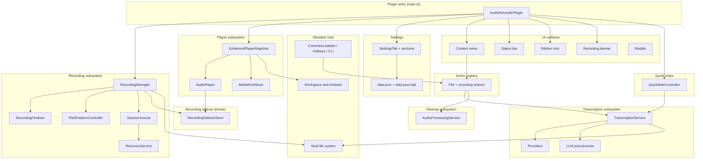
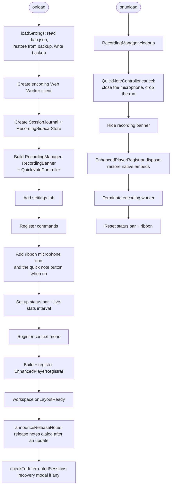
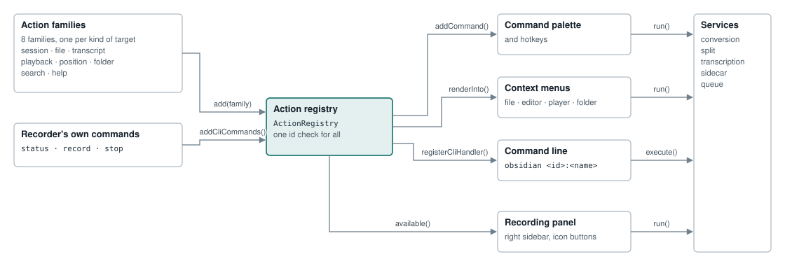
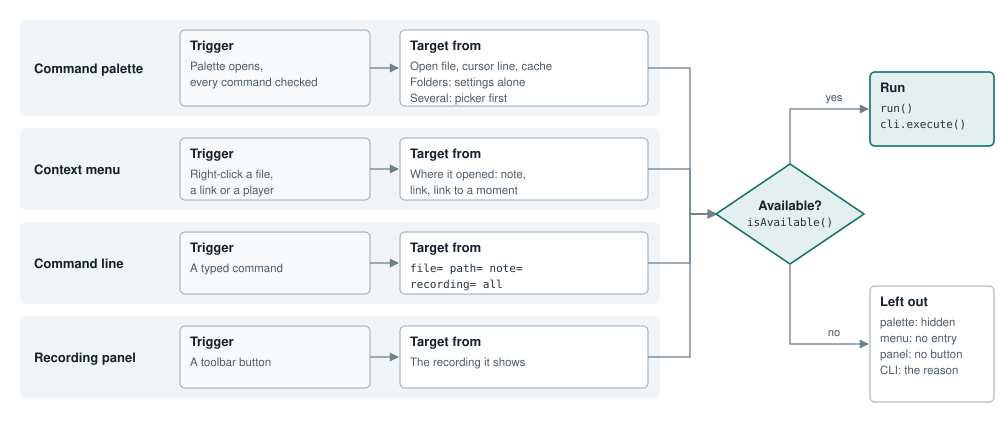
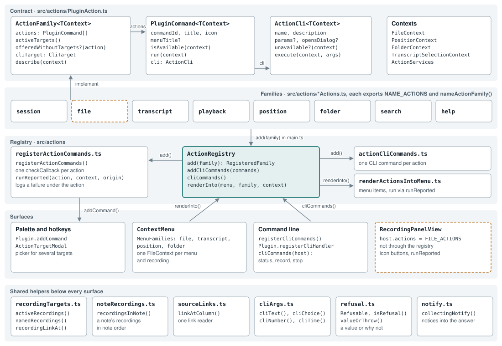
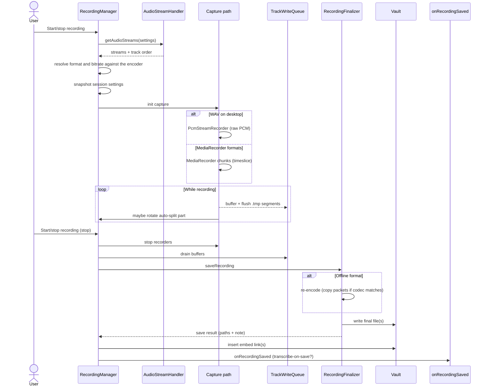
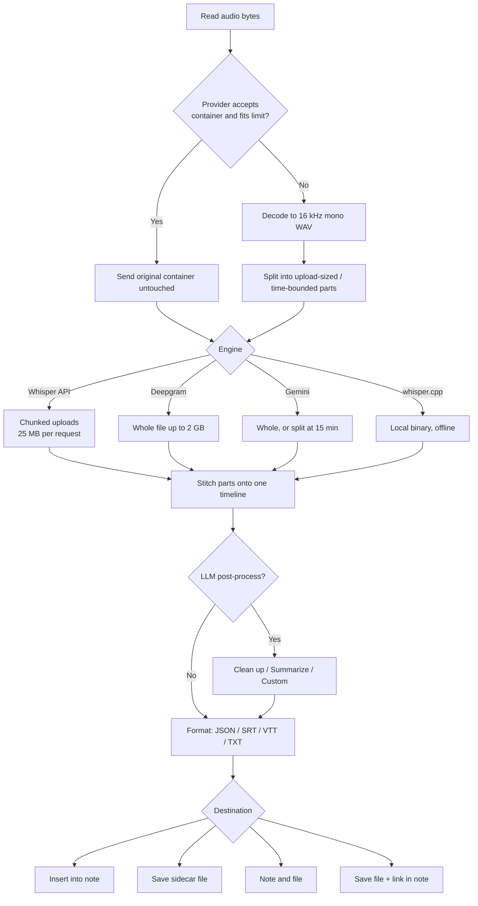
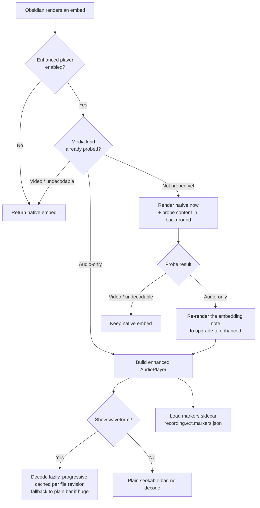
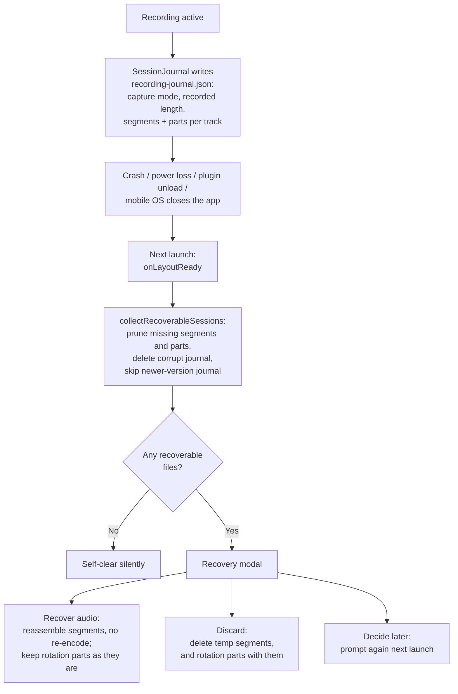
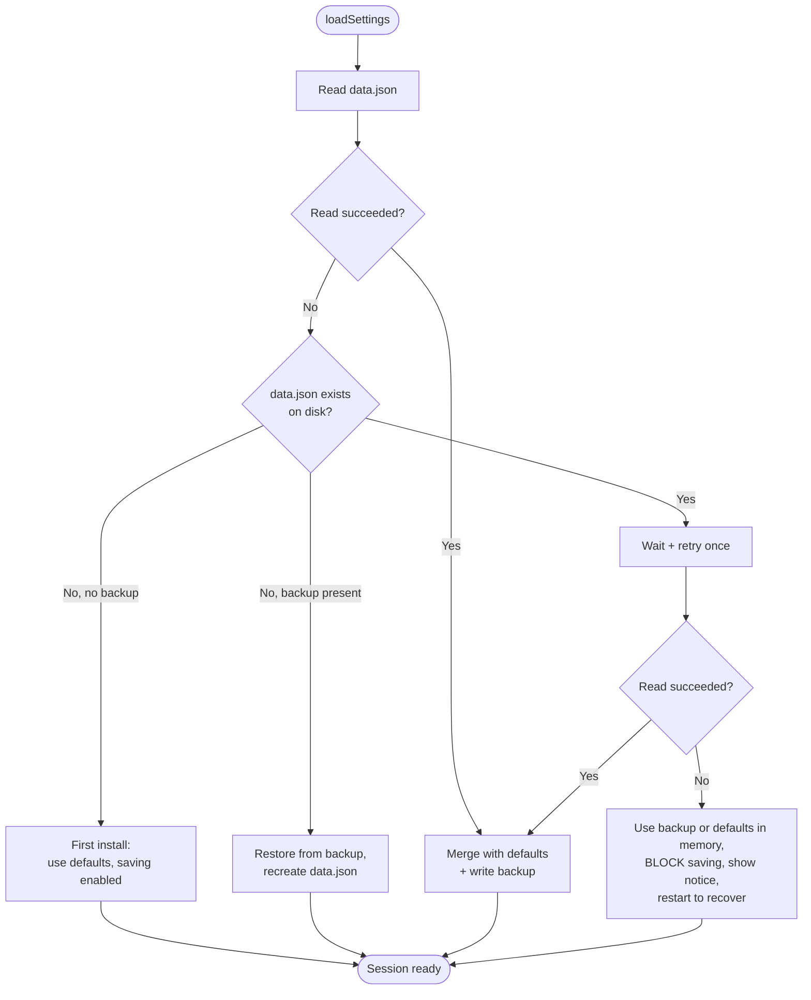

# Architecture

This document is a technical map of how **Advanced Audio Recorder** is put together: how the plugin loads, how a recording flows from microphone to file, how transcription and the enhanced player work, and how crash recovery and settings backup keep your data safe. It is written for contributors and curious power users. If you only want to _use_ the plugin, start with [Getting started](getting-started.md) and the [Features overview](features.md). Come back here when you want to know _why_ something behaves the way it does, or where in the source a behavior lives.

Everything below is verified against the plugin source under `src/`. The plugin runs on **desktop and mobile** (it requires Obsidian `1.14.4+`). Platform differences are decided in one low-level policy layer, `src/platform/` (`platformKind.ts` detects the platform, and `capabilities.ts` answers "is this feature available here?" and "which limit applies here?"). Feature code and the settings UI branch on named capabilities - multi-track capture, device selection, PCM WAV capture, mid-stream segment flushing, local transcription, memory ceilings - never on the platform itself. Device-bound settings (input device ids, channel layouts) are stored per platform under a `perPlatform` branch in `data.json`, so a vault synced between a desktop and a phone never mixes their hardware configuration.

- [System overview](#system-overview)
- [Plugin lifecycle](#plugin-lifecycle)
- [Actions](#actions)
- [Recording pipeline](#recording-pipeline)
- [Transcription pipeline](#transcription-pipeline)
- [Enhanced player takeover](#enhanced-player-takeover)
- [Reading how long a recording is](#reading-how-long-a-recording-is)
- [Crash recovery](#crash-recovery)
- [Settings load and backup](#settings-load-and-backup)
- [Settings tab rendering](#settings-tab-rendering)
- [Interface components and styling](#interface-components-and-styling)
- [Module map](#module-map)

---

## System overview

The plugin entry point (`src/main.ts`) constructs a small set of long-lived managers and registers them with the Obsidian host. Each subsystem owns one concern: recording, playback, transcription, on-demand cleanup, settings, and the shared UI surfaces (status bar, ribbon, modals, context menu).

What to notice:

- **The plugin object is a thin coordinator.** `main.ts` builds the managers, wires their callbacks, and forwards UI events to them. The real work lives in the subsystem classes.
- **One `RecordingSidecarStore` is shared** by the recording subsystem (which writes markers captured during a session), the player subsystem (which reads and edits them), auto chapters, and the transcription feature (which stores the speaker roster, the recording's participant names, and the written outputs in the same sidecar document), so their cache and serialized write chain stay unified. The marker data model is a standalone domain (`src/markers/`), owned by neither subsystem. The sidecar persistence lives in `src/sidecar/`.
- **A sidecar is an ordinary vault file, handled through the Vault API.** The store never reaches past the vault to the raw adapter for a file the vault lists, so the index, the other plugins' vault events, and the user's trash preference all see sidecar operations the way they see any other file:
    - **Read** with `Vault.cachedRead` after `Vault.getFileByPath`. The vault refreshes that cache on its own writes and on the modify events its watcher raises for an edit by sync or another program, so it can only miss a change it has not been told about yet. `Vault.read` would close that millisecond window and nothing more, because the store caches each document for the session and treats the cache, not the file, as authoritative - the property that lets a marker edit and a transcript write share one document.
    - **Written** with `Vault.modify` for a file the vault lists and `Vault.create` for a new one. Not `Vault.process`: the base of every mutation is the cached document, so the text it hands over would be thrown away. A `create` refused because the path was taken in the meantime falls back to writing the file that is there, under one rule: a document the store built from nothing (no file stood behind it) is never written over a file that appeared - sync delivering the sidecar of a recording that arrived a moment earlier - but dropped, and the change is applied again to the file's own document. The same rule holds for a file found at the path before the write.
    - **Moved** with `Vault.rename`, not `FileManager.renameFile`: nothing links to a sidecar, so a link-updating rename would only scan the link graph. A file already at the destination is an orphan (the recording did not exist under that name) and goes to the trash rather than blocking the move.
    - **Deleted with its recording** through `FileManager.trashFile`, which follows **Deleted files** exactly as the recording's own deletion did, so restoring both from the trash restores the markers and transcript data.
    - **Removed when emptied** with `Vault.delete`. That is the store tidying its own data rather than a user deleting a file, and it happens routinely - a sidecar holding only a playback position empties every time a recording is heard to the end - so trashing it would leave a stray file per finished listen. The obsidianmd `prefer-file-manager-trash-file` lint warning on that call is expected. The plugin's review config forbids silencing it inline.
    - **Before the index is built.** Obsidian indexes the vault while plugins load, so early in startup `getFileByPath` can answer null for a sidecar that exists. Reads and writes then fall back to the adapter for that one file (existence, read, write, remove), so its markers are neither hidden nor replaced. Rename and delete do not: they answer vault events, which only fire for indexed files, and a sidecar the index does not list at that moment is already being carried along with its folder.
    - **Events it causes.** The store's own rename of a sidecar fires the vault's rename event, which the registrar's output-rename hook ignores (sidecar paths are skipped) and which re-indexes the recording at the new path, the way a create does. Its trash and delete fire the delete event that drops the recording from the marker search. Its create and modify fire the events that re-index it. The re-index on rename matters when an orphan sat at the destination: trashing it drops the new path from the search just before the moved sidecar arrives there.
- **Every action is defined once, in a shared action registry** (`src/actions/`). An action is a `PluginCommand<TContext>`: an id, a title, an icon, an availability gate, a run step, and a required command-line binding, all over the context it needs. Actions come in families - the session over the recorder, the file actions over a recording, the transcript edits over lines of a note, playback over what is playing, positions over a time in a recording, folders, search and help - and a family says, besides its actions, which targets the palette acts on now, how the command line names a target, and how a target is described. `ActionRegistry.add` registers each action of a family as a palette command and collects it as a command-line handler, and the context menus render only registered families, so an action cannot be in one surface and missing from another: the compiler refuses an action without its command-line binding, and the registry refuses two actions with one id. When the palette finds several targets (a note embedding several recordings, the folders of the vault), it asks in a fuzzy picker. Obsidian runs every command's check each time the palette opens, so a family's active targets come from what is already in memory: the active file, the line under the cursor and the metadata cache, read through one `recordingsInNote` in `src/obsidian/noteRecordings.ts` that the menus and the recording panel share. The folder family, whose targets take a pass over the whole vault, answers the check from its settings through `offeredWithoutTargets` and lists the folders only when the command runs. On the command line a target is named with `file=`, `path=`, `recording=`, `note=` or `all`, and the action runs headless over the same services the dialogs use. The services report through an injected notifier, which the command line collects into its answer instead of raising notices. Adding a feature is an entry in a family, with no registration code of its own. See [File operations](file-operations.md), [Audio player](audio-player.md#playback-commands-and-hotkeys) and [Command line](command-line.md).
- **Settings persist to `data.json`** with an automatic `data.json.bak` next to it, described in [Settings load and backup](#settings-load-and-backup).

---

## Plugin lifecycle

`onload()` runs once when the plugin is enabled. It loads settings (with backup restore), builds the managers, registers commands and UI, and schedules the release-notes announcement and the crash-recovery check for after the workspace is ready so plugin load is never delayed. `onunload()` tears everything down cleanly.

Notes on the lifecycle:

- **Settings load first**, because every manager constructed afterward receives a live `settings` reference. The load path can restore from `data.json.bak` and even block saving when the stored file is unreadable (see [Settings load and backup](#settings-load-and-backup)).
- **Streaming conversions are offloaded to a Web Worker** when the build injected its source. If that source is unavailable, everything falls back to the main thread.
- **Commands come from one place**, the shared action registry, which resolves each list's context afresh on every palette check and hides a command whose context does not resolve. The session list runs against the recorder, where `Start/stop recording` is always offered because starting a session is what it does when none is running, `Start/stop quick note` is offered only while quick notes and transcription are both on, `Pause/resume recording` needs a live session, the marker commands (`Add marker/chapter at current position` and the kind-fixed `Add bookmark at current recording position` and `Add chapter at current recording position`) need markers enabled and a live session, and `Select audio input device` is hidden where the platform cannot pick one. The file list runs against the active audio file, or the recordings the active note embeds or links - the one under the cursor when the cursor is on its link - (`Audio file info`, `Convert audio format`, `Split audio into parts`, `Clean up audio`, `Transcribe audio`, `Transcribe the parts that failed`, `Rename speakers`, `Generate chapters from transcript`, `Export chapters and markers`, `Delete recording`, `Delete recording & link to file`), each with its own settings gate on top. The playback list runs against the playback as it stands at the moment of the check, pulled from the registry rather than reused from the snapshot the status bar was last pushed, and covers transport, the two speed steps, and the two chapter jumps, all absent while nothing plays. The position list acts at a time in a recording: in the palette where the playback stands, in the player menu where the user right-clicked, on the command line at `at=` - `Add bookmark at current playback position`, `Add chapter at current playback position` and `Copy timestamp link at current playback position`. The folder list offers `Transcribe every recording in a folder`, over every folder that holds a recording. The transcript list runs against the selection of the active editor, resolved only when the first line it covers carries a timecode link that reaches a recording: a selection inside that one line offers `Split selection into another speaker`, and one reaching over further lines offers `Merge selected lines into one`. The editor menu renders the same list for the selection it was opened on. The search list and the help list are bound to nothing in the vault, so their context always resolves: `Search markers and chapters`, `Show the transcription queue` and `Open the recording panel` in the first, and `Show what's new` in the second, which opens the release notes of every version the build carries. No default hotkeys are assigned - see [Recording](recording.md), [Audio player](audio-player.md#playback-commands-and-hotkeys), and [Settings reference](settings-reference.md).
- **What an update changed is announced once**, from the same layout-ready callback and ahead of the recovery check, because both can open a dialog and a recording the app lost is the one the user has to answer first. The version is recorded whether or not the dialog opens, and a config that has announced nothing yet records the running version without showing anything, so neither a first install nor the upgrade into the first build with this dialog meets the whole history. See [After an update](getting-started.md#after-an-update).
- **Recovery runs after layout is ready**, never during load, and a failure there is caught and logged so it can never break the plugin.
- **Unload restores Obsidian's native embeds first** (so disabling the plugin never leaves overridden media embeds behind), then flushes recording buffers best-effort. The crash-recovery journal is deliberately _not_ ended on unload - an unload mid-recording is exactly the case the next launch should offer to recover.

## Actions

Every action of the plugin is defined once, in a family of `src/actions/`, and one `ActionRegistry` hands that definition to three of the four places a user reaches it from: the command palette with its hotkeys, the context menus, and Obsidian's command line. The fourth, the recording panel in the right sidebar, draws the file actions as icon buttons from the same `FILE_ACTIONS` list, read directly rather than through the registry. All four run an action over the same services the dialogs use, so a conversion started from a menu, a hotkey, the panel or a script is the same conversion. The recorder's own command-line commands (the status, `record` and `stop`) go through the registry too, which is where the one check that no two commands share an id lives. In the pictures below the shared core is teal, the panel's direct read is a dashed amber line, and every arrow points from the part that hands over or calls to the part that receives. They show the code at the branch of [#125](https://github.com/akhmialeuski/advanced-audio-recorder/pull/125).

The surfaces differ only in how they find the target. The palette reads what is active, and it does so every time it opens, for every command, so this read stays in memory: the open file, the line under the cursor and the metadata cache, through one `recordingsInNote` and one `recordingLinkAt`. The folder family, whose targets take a pass over the vault, answers that check from its settings through `offeredWithoutTargets` and lists the folders only once its command runs. A menu builds its context from where it was opened, the note, the link under the click and whether that link points at a moment, and the file and editor menus Obsidian raises for one click add to one shared context. The command line names the target with `file=`, `path=`, `note=`, `recording=` or `all`, and the panel acts on the recording it shows. From there one path serves all four: the action's own availability gate decides, and the action runs, or is hidden from the palette, left out of the menu and the panel, or answered with its reason on the command line.

The classes sit in layers. The contract, `PluginCommand`, its `ActionCli` binding and the `ActionFamily` that groups commands over one kind of context, lives in `src/actions/PluginAction.ts`. Eight families implement it, each exporting its list and its family function, and `main.ts` adds them to the `ActionRegistry`. The registry lays them out through three helpers: `registerActionCommands.ts` registers one `checkCallback` per action and runs it through `runReported`, `actionCliCommands.ts` builds one command-line command per action, and `renderActionsIntoMenu.ts` adds the menu items. The surfaces call the registry, except the panel. The shared helpers, which resolve targets, read a note's recordings and links, parse command-line arguments and collect notices, sit below every surface and import none of them.

On the command line the services report through a collecting notifier rather than straight to notices, so what a dialog would show along the way, such as a converted file that already existed, ends up in the printed answer as well as in a notice in the app. Adding an action is an entry in a family: the compiler refuses one without its command-line binding, and from there the palette command, the menu entry and the command-line command all exist.

---

## Recording pipeline

A recording is driven by `RecordingManager`. When you start, it acquires the input streams first, then resolves the format and the bitrate against the audio those streams will really produce, and finally snapshots the session-scoped settings (format, mode, bitrate, auto-split config) and chooses one of two capture paths. When you stop, it drains buffers, finalizes the files, writes them, inserts the embed links, and fires the optional transcribe-on-save hook.

The streams come before the format and bitrate checks because both are questions about a file, not about a codec. What the encoder accepts depends on the sample rate and the channel layout it is handed, and the layout is only settled once the tracks are open - a settings edit made while the microphone permission dialog was still up would otherwise describe a different session than the one being recorded. Both checks probe the real encoder, so a format or a bitrate that would only fail after the recording is over is replaced, with a notice, before the first sample is captured. See [Bitrate guidance](formats.md#bitrate-guidance) for what each check can substitute and why.

Key decisions in this pipeline:

- **Two capture paths.** WAV on desktop uses a `PcmStreamRecorder` that captures raw PCM directly and assembles a WAV on save - this streams to disk and handles long recordings reliably. Every other format (and WAV on mobile) uses a `MediaRecorder` started with a chunk timeslice, delivering compressed chunks. Format details and the online-vs-offline distinction are in [Formats](formats.md).
- **Buffering and flushing.** The `TrackWriteQueue` serializes per-track writes. Chunks accumulate to a flush threshold and are written to `.tmp` segment files. These segments are what the crash-recovery journal tracks.
- **Auto-split rotation.** When auto-split is on (desktop, and not for a merged multi-track session), `PartRotationController` finalizes a part at each boundary while recording continues. WAV parts are split sample-exactly. Compressed formats restart the recorder per boundary. See [Splitting](splitting.md).
- **Finalization.** `RecordingFinalizer` produces the final files and reports the save-progress stages you see in the status bar (`Saving > Flushing buffers > Assembling audio > Writing file > Cleaning up > Saved`). Offline formats are re-encoded here. Packets are copied without re-encoding when the codec already matches.
- **Multi-track output.** In `Single file` mode the tracks are mixed into one file. In `Multiple files` mode each track is saved separately, with the source/device name (and the track number appended to disambiguate when tracks share a device). See [Multi-track recording](multi-track-recording.md).
- **Transcribe-on-save.** When `Transcribe after recording` is enabled, the hook transcribes only the first saved file - a multi-track session records the same audio per track, and an auto-split session would otherwise fire one request per part. See [Transcription](transcription.md) and [Transcribe after recording](use-cases/transcribe-after-recording.md).

---

## Transcription pipeline

`TranscriptionService` (in `src/transcription/`) reads the audio, prepares provider-ready payloads, transcribes each through the configured provider, stitches the results onto one timeline, optionally post-processes with an LLM, and renders the output. `runTranscription.ts` is the high-level entry point that then writes the configured destinations.

How the stages map to behavior:

- **Preparation is lazy.** When a provider accepts the original container and the file fits the per-request limit, the bytes are sent untouched - no decode, so peak memory stays at the encoded file size. Only when the container is unsupported or the file is too large/long does the service decode to 16 kHz mono WAV and split it into upload-sized (or time-bounded) parts. Each part materializes its WAV bytes only just before upload, so a multi-chunk job never holds more than one chunk in memory.
- **Per-engine limits and behavior.** Whisper API has a hard 25 MB per-request limit (larger files are resampled and chunked, then stitched, without diarization). Deepgram sends up to 2 GB whole with consistent diarization. Gemini uploads up to 2 GB whole, decodes containers it does not accept, and splits recordings longer than 15 minutes into stitched parts (diarized splits reset speaker numbering, surfaced as a warning). Mistral Voxtral uploads up to 1 GB whole with consistent diarization, decodes containers it does not accept, and declares no duration cap, so a recording that decodes to more than one request can carry is refused with the reason rather than uploaded and rejected by the endpoint. Local whisper.cpp runs a local binary fully offline. See [Transcription](transcription.md#engines) and the engine setup guides under [Use cases](use-cases/index.md).
- **Stitching.** Successful per-part transcripts are merged onto the original timeline. A part that overruns a provider's output-token budget is subdivided and retried rather than discarded. A part that fails outright is recorded as missing, and the run keeps the good parts and warns instead of failing the whole job.
- **Diarization is one gate for the whole run.** The effective diarize flag decides both whether speaker labels are requested and whether any returned labels are stripped, so the request-time and output-time decisions can never diverge. Diarization is only available for Deepgram, Gemini, and Mistral Voxtral. See [Speakers and diarization](transcription.md#speakers-and-diarization).
- **LLM post-processing is best-effort.** A failure falls back to the raw transcript rather than discarding completed (and possibly already-billed) work. See [LLM post-processing](llm-post-processing.md).
- **Output is rendered then written.** Markdown is built with optional clickable `#t=` timecode links, and `runTranscription.ts` writes the sidecar file and/or inserts into the note per the `Destination` setting. If in-note insertion is the only requested destination but it fails (note not open, reading mode), a sidecar file is written as a safety net so a completed transcript is never silently dropped.

---

## Enhanced player takeover

`EnhancedPlayerRegistrar` is the single decision point for whether an embedded audio file gets the enhanced `AudioPlayer` or Obsidian's native embed. It registers a custom embed creator in Obsidian's internal embed registry (with a Markdown post-processor as a Reading-view-only fallback), classifies each file by probing its actual content, and upgrades open views once a file proves audio-only. The `AudioPlayer` itself is a thin coordinator over focused collaborators: `SeekController` (seeking and timecode math), `WaveformController` (peak decode and cache), `PlayerMarkerController` (bookmark/chapter edits), `DurationProbe` (cheap metadata-only duration read), `MediaEmbedShell` (the embed DOM shell), and the `PlayerControlsView`, `WaveformCanvas`, and `MarkerListView` views.

What this buys you:

- **Container classification, not extension.** The media kind is always determined by probing the actual content, cached per path, and persisted in the plugin folder (`MediaKindStore`), so an audio-only `.mp4` or `.webm` still gets the enhanced player, a file carrying a video track keeps Obsidian's native player, and the probe never repeats across sessions. The probe asks mediabunny for the container's tracks over the file's resource URL, read by range and never retried, and accepts an audio-only answer only for a type `canPlayType` recognises. A container it cannot read, or a type the browser does not know, falls back to loading the file's metadata into a detached `<video>` element, whose four-second timeout yields an unpersisted guess. See [Audio player](audio-player.md#audio-video-and-unsupported-files).
- **Both view modes stay correct.** Returning Obsidian's native embed unwrapped is what keeps Live Preview and Reading view consistent. The same re-render mechanism applies player setting changes immediately and identically in both modes.
- **Waveforms are cheap to scroll.** Peaks are computed once per file revision and cached, decoded lazily and progressively as the player scrolls into view, and fall back to a plain (still seekable) bar above a large safety size or when the file cannot be decoded. Turning off `Show waveform` skips decoding entirely.
- **Markers live in a sidecar.** Each recording's bookmarks and chapters are stored in a `recording.ext.markers.json` sidecar next to it. The registrar has the store move the sidecar on rename and send it to the trash on delete, through the Vault API, so markers stay attached (see [System overview](#system-overview) for how the store handles the file). Edits are allowed in Live Preview and read-only in Reading view. See [Markers and chapters](audio-player.md#markers-and-chapters).
- **Timecode links play from the offset in both view modes.** A document-level click handler intercepts `#t=` links that point to an audio file and plays from that offset instead of opening the file. It resolves the link the same in Reading view (a rendered `a.internal-link`) and Live Preview (read from the editor source, since CodeMirror renders the link without an attribute), seeks an on-screen embed in place when one exists, and otherwise plays the file's shared element through note-independent `DetachedPlayback` surfaced in the status bar.
- **The speaker preview is the one deliberate exception to the shared element.** `SpeakerPreviewPlayer` (used only by the rename dialog to play where a speaker first talks) owns its own element: a two-button excerpt must not hijack the embed of the same recording in the note behind the dialog, nor appear in the status-bar transport, which offers seek, skip, and markers. It still drives that element through the same `playbackCommands`, so seeking and stopping behave identically, and it is disposed with the dialog.
- **The cleanup chain runs on the live signal as well as on a file.** `LiveVoiceBoost` in `player/` renders the same three stages the offline cleanup writes into a `...-processed.wav`, with the values resolved from the same `cleanup/audioDsp` configuration, as Web Audio nodes placed between the shared audio element and the output. The graph belongs to the registry rather than to a player, because a media element can be routed into an audio graph only once in its life while a player is rebuilt on every render pass: the graph is built on the first engage and rewired by every toggle after it, and the untouched path is a straight wire to the destination, since a routed element reaches the speakers only through the graph. One realtime `AudioContext` serves every element and is closed when the registry is cleared, which is what keeps contexts from accumulating. See [Voice boost](audio-player.md#voice-boost).
- **One audio element and one command set per file.** Every playback surface - the embedded `AudioPlayer`, the status-bar controls, and `DetachedPlayback` - operates on the single shared element the `AudioPlayerRegistry` keys per file, and every play, pause, stop, skip, mute, volume, and seek routes through `src/player/playbackCommands.ts`. Keeping one element and one command source is what stops the surfaces drifting out of sync (playback running while an embed still reads `0:00`). Because mocked unit tests hid exactly that drift, a change to any playback surface must add a real integration test that drives the actual `AudioPlayer` against a real registry, as in `tests/integration/PlaybackSync.test.ts`.

---

## Reading how long a recording is

The length of a file is asked for all over the plugin - the cost estimate before a run, the bound a generated chapter has to fall inside, the guard that refuses a file too big to clean up, the seek bar - and there are three readers of it, in increasing cost. The container headers come first, through mediabunny in `src/utils/AudioFileAnalyzer.ts`, which parses structure instead of samples and settles most files for nothing. When they carry no length, the browser is asked next: `src/utils/mediaDuration.ts` loads metadata into a detached element and, if that still reports nothing usable, seeks far past the end so the engine reads on to the last packet and announces the real value. Only when the container did not parse at all does the full `decodeAudioData` run, because the sample rate and channel count exist nowhere else, and that path is bounded by the platform's decode ceiling. Where the container did parse and the browser still produced no length, the length simply stays unread: a media element and `decodeAudioData` are the same engine, so decoding would expand the whole recording to PCM to ask a question that was already answered no.

The order matters because of what this plugin records. A recorder streaming into a container stamps no length into a segment it has not finished, so the plugin's own recordings are exactly the files the headers cannot answer for, and they are also the long ones. Answering them with a decode would put gigabytes of PCM behind the cheapest question in the plugin, every time a transcribe dialog opens. The media read costs no samples at all. The enhanced player resolves its seek bar with the same manoeuvre through `DurationProbe`, which shares both the far-seek constant and the rule for what counts as a usable answer rather than keeping a second copy of either: an `Infinity` before the seek and a finite zero after the load are both "not yet", and a probe that stopped on either would lock in a number that is not a duration.

The rule of what the three readers are chained into is written once and parameterized by where the length comes from, because the two callers differ in nothing else. A caller holding bytes already, such as the transcribe dialog, hands them to a blob the browser reads. A caller holding a vault file hands the resource URL, which serves ranges and is what the header parse streamed from in the first place. Reading such a file in to ask the browser instead would hold the whole recording in memory, and a second copy of it for the blob, to learn one number the address already on hand gives for nothing - on precisely the recordings this plugin produces. So bytes are read only where the container did not parse at all, which is also the only case where a decode could contribute anything the parse did not.

A length no reader could produce is `null`, not `0`. The distinction is load-bearing: a recording of unknown length is not one that costs nothing to transcribe, and it is not one that fits under every ceiling either. `ProbedAudioMetadata.durationSeconds` is therefore nullable, so every reader has to decide what it does without a length instead of inheriting a zero that reads as an answer, and the shared `isKnownLongerThan` is how each ceiling guard declines rather than treating unknown as short. Which reported numbers are a length at all is one rule too: a media element, a container parse, and a decode each say "nothing was read" in their own way, and `usableSeconds` turns all three into the same `null` so no reader has to recognise them itself.

---

## Crash recovery

While a recording is active on either platform, `SessionJournal` records what it has already put on disk in `recording-journal.json` inside the plugin folder. If Obsidian crashes, loses power, the plugin is unloaded mid-recording, or a mobile operating system closes the app in the background, the next launch collects the surviving sessions and offers a recovery choice through `RecoveryService` and a modal.

The journal entry carries a capture mode, because the two pipelines leave different things behind and the choice offered to the user differs with them. A `stream` session flushes raw mid-stream segments that only mean something together with the journal listing them, so recovery reassembles them and its part files are auto-split output it never touches. A `rotation` session, which is what a platform without `midStreamSegmentFlush` records, turns every flush into a whole part, so its part files are the interrupted recording itself: recovery hands them back as they are and a discard deletes them. The mode is decided once at session start, next to the boundary policy it belongs to.

Important details:

- **What can be recovered.** Everything already flushed to disk can be reassembled. In-memory audio still buffered below the flush threshold at the moment of the crash cannot. Recovery never transcodes - a raw reassembled container (or a WAV for PCM sessions) is the safest artifact a truncated stream can produce.
- **Pruning self-clears.** `collectRecoverableSessions` drops segments and part files (and tracks, and sessions) whose files no longer exist and persists the pruned journal, so a crash before the first flush self-clears without ever prompting, and an entry pointing at a part the user has since deleted does not accumulate. A corrupt journal is deleted. A journal written by a newer plugin version is left untouched so a downgrade never destroys recovery data it cannot interpret.
- **MediaRecorder header rule.** A compressed track is only playable from its first segment (which carries the container header). If that segment was lost, the track is marked discard-only rather than producing an unplayable file.
- **Recover, Discard, Decide later.** Recover reassembles surviving segments, removes the consumed temp files, and names back the rotation parts it kept in place, which already carry the names the normal finalization would have given them. Discard deletes the temp segments, together with the part files of a rotation session and never those of a stream one. Decide later leaves everything in place and the prompt returns next launch. See [Crash recovery](recording.md#crash-recovery) in the recording guide.

---

## Settings load and backup

Settings persist to `data.json` in the plugin folder, with a `data.json.bak` copy kept next to it. The load path in `main.ts` carefully distinguishes "no settings yet" (first install) from "settings exist but cannot be read" (a transient lock during a plugin update, a truncated file), and protects the stored file in the latter case.

Why it works this way:

- **Missing vs. unreadable is decided by an explicit `exists()` check**, not by the `loadData()` return value, because some filesystems map a missing file to the same result as a failed read.
- **The backup is refreshed on every successful load and save.** When `data.json` goes missing but the backup is present, the settings are restored _and a new `data.json` is written immediately_ so the backup is never left as the only copy.
- **An unreadable `data.json` blocks saving.** The session continues on the backup (or defaults), saving is disabled so the possibly intact and possibly newer stored file is never overwritten with fallback values, and a notice tells you to restart. A protective `exists()` failure is treated as "file present" so a possibly intact file is never overwritten.
- **External changes reload.** `onExternalSettingsChange` (sync, manual edit) reloads settings so a stale in-memory copy does not overwrite the external change on the next save.

See [Settings reference](settings-reference.md) for every individual setting and its default.

---

## Settings tab rendering

Obsidian renders the tab from the definitions returned by `getSettingDefinitions()` and owns the DOM around every definition: after each pass it resets the group's list element to exactly the rows it tracks and the tab container to the group elements, so anything drawn beside a tracked row is discarded again, and a row the definition removed is put back. The deprecated `display()` is not implemented at all, because Obsidian never calls it for a tab that declares its settings, and the plugin requires a version (1.14.4) that renders every shape the tree declares.

The tab is described once, as data, in `settingsDefinitions.ts`. That tree _is_ the tab: the framework renders it, indexes every setting for the settings search by its name and its declared `aliases`, reads and writes the values, runs the validators, and re-evaluates the `visible` and `disabled` predicates after every change. The aliases matter twice over - they let a user find a row by the thing rather than by our word for it ("microphone" reaches the input device, "speech to text" reaches transcription), and they are the only way the fields inside a hand-rendered block are reachable at all, because the search indexes definitions and such a block is one definition.

What a control accepts is its declaration. A control declares its value space and the whole of it: the bounds a number lies between and the grid of `min + n * step` it sits on, and then whatever its `validate` adds beyond that. The framework enforces all of it, refusing the change and stating why rather than storing what the declaration rules out, and it checks the seeded value once on mount so a config written by an older version, or synced from a device with other capabilities, is reported rather than silently taken. The tab never rewrites a stored value it disagrees with, because that value is the user's and it works again the moment the vault is opened where it came from. A bound no grid point reaches is a declaration that cannot be satisfied, so the test suite checks every number control of the tree against that rule.

Three shapes beyond the plain group carry the rest of the tab. The saved model ids and the profile catalogues are `type: 'list'` collections: the framework draws the rows, the add affordance (on desktop a plus icon in the group header, whose tooltip names the entry and which the stylesheet moves onto the filter's line when the list has no heading of its own, and on mobile a tappable row under the list), and the empty state, and each one declares a `search`, which is Obsidian's own filter over that collection - typing narrows the list in place, and the tab contributes no filtering code of its own. A list is where entries are managed, not where a value is chosen: which model an engine runs on is a dropdown over the saved ids on the engine's own page, because picking one of a handful of known values is what a dropdown is for, while the catalogue behind it answers the other question of which ids exist at all. Adding an entry to a list opens a dialog rather than growing a form in the tab, as the guide asks. Where an entry is a plain string the framework's own delete button ends it. Where it is an entity with a page of its own, deleting belongs on that page, so the profile catalogues declare no `onDelete` at all.

A profile is such an entity, and one mechanism serves every kind of them. Every profile of every kind is one entry of a single stored list, `profiles`, carrying the kind it belongs to, and the profile a kind applies is one entry of the `selectedProfileIds` map beside it. A kind is therefore a description in `profileKinds.ts` - its copy, what an entry says about itself, and which block of the settings shows it - rather than a stored list and a selection field of its own. The same builder turns any of those descriptions into a list of pages, so the glossaries, the participant rosters, the chapter guidance and the three post-processing prompts differ in their copy and in nothing else, and a seventh kind is one more entry in that registry. What a run makes of a body is the only thing left per kind, and it lives apart from the storage in `profileResolution.ts`: a glossary parses terms out of the text, a roster parses names, a prompt is the text itself. Each profile's page carries its body across the full row, a switch deciding whether the Transcribe dialog offers it, and the rename and delete actions. The control keys of those rows carry the profile's id, so a row on one profile's page cannot write to another's. The name is taken in a dialog rather than in a field on the page, because the framework addresses an open page by its name path: renaming under itself would leave the page unresolvable, so a rename applies and returns to the list, and deleting does the same.

Those collections are what makes `type: 'page'` worth using at every level. Transcription is a page, because forty-odd settings with a scope of their own belong behind one entry rather than inline on the main tab. Each collection is a page of its own inside it, because a vendor catalogue runs to thirty-odd model ids and a glossary to as many profiles, and inline that is thirty rows between the engine and everything configured after it. With Deepgram selected and six profiles of each kind, the transcription page carries 40 rows instead of 96. Six more sections went the same way for the same reason, since they are set once and then read past on the way to something else, or opened only when something is wrong. Those are audio splitting, multi-track recording, the audio player, audio processing and feedback, the audio cleanup defaults, and diagnostics. What the main tab keeps inline is what a recording is configured with before a session: the input, the output format, and where the file goes.

Every page entry declares a `displayValue`, so what it holds is readable without opening it, and what that value says follows what the page is. A page with one master switch reports it, which is how transcription and the player read. A page with a value behind a switch reports the value, so audio splitting says how often a recording is cut rather than merely that it is. A page of independent switches has no single value and reports how many are on, counted from its own rows so a switch added later is counted without being registered twice. The cleanup defaults name their enabled stages instead, because a count would not say which two of the three the dialog would open with.

The services the plugin talks to are declared once, in `src/providers/providers.ts`, and the settings follow that shape. A provider is one account with one endpoint and one key, and some of them answer more than one kind of request: Gemini, OpenAI, and Mistral all transcribe audio and run the post-processing prompts, Deepgram only transcribes, Anthropic only writes, and the local engine has neither endpoint nor key. Mistral reaches its two jobs through two catalogues over that one account, because the `voxtral-*` ids transcribe and the `mistral-*` ids write, so the account is entered once and each catalogue is picked from separately. Each provider therefore has a page of its own under the Engines entry, holding that connection and the catalogues it serves, while the transcription block and the post-processing block keep only the choice of which provider does the work. Before this, a provider that did both had its key on two rows and two endpoints for one account, and switching the post-processing vendor rewrote a shared base URL.

Writing that configuration goes through one function, `applyEngineSettings` in `src/providers/engineSettings.ts`, which every engine names itself to. Nothing in it branches on which engine it holds: the fields come from that engine's own descriptor, so an engine with no account has no endpoint to move and one with no catalogue no model to pick, and adding an engine to the registry is what gives it its configuration, its catalogue edits, and its save. Two rules therefore hold wherever a change comes from, rather than at each place that makes one. A field the engine does not declare is not written, so a patch naming one is a question that engine has no field for instead of a value landing somewhere. And the catalogue and its selection come out consistent, because an id held outside its own list is a selection the user can neither see nor change. The load path asks for exactly that by applying the empty change to every engine, so a config read from disk satisfies the rule an edit satisfies. `engineSettingsStore` binds the function to one engine and one way of persisting, which is what the settings tab, the transcribe dialog, and the chapters dialog each hold, and the settings tab routes a key-addressed control through it as well, so a row on an engine's page and an edit from a dialog are the same write.

One thing the tree carries for the stylesheet rather than for the framework is a class on every group it declares, because a group is the only shape that takes one and a block of settings is what the eye should group by. Obsidian rules the rows inside a block and separates one block from the next by a background alone, which in a low-contrast theme reads as one long ruled list. The stylesheet turns that around, switching the row divider off through Obsidian's own `--setting-items-divider-width` and drawing a line between the blocks instead. That class is also the scope: a container holding one of those groups holds only this tab's blocks, so the rules reach the groups the framework builds around loose rows and nothing outside these settings. A page whose rows are one block therefore declares that group itself rather than leaving the framework to wrap them.

A handful of rows keep a render callback, because no control type covers them: the documentation callout, the recording format (whose options are blocked one by one by an asynchronous encoder probe), the audio bitrate (whose options depend on that format, on the sample rate, and on the same probe, so the list is rebuilt whenever one of them moves, and the row disappears altogether for a lossless format that carries no bitrate), the output summary (derived from the format and bitrate rows rather than stored), the diagnostics test capture (which reports into its own row and owns a cleanup), each account's API key, which is a password input the declarative control set has no type for, and the local engine's binary and model paths, which are file pickers. There is one key block per account rather than one per job now, and it sits on the page of the engine it credentials, so nothing about it changes with what is selected elsewhere. Those password fields still follow Obsidian rather than invent: the reveal button beside them is the eye toggle from the app's own keychain dialog, icon and all. Everything else is a control, an action, a group, a list, or the page.

Obsidian 1.13 does offer somewhere else to put a secret - `app.secretStorage`, encrypted through Electron's `safeStorage` and surfaced by `SecretComponent`. The tab does not use it. A secret there is stored per device and outside `data.json`, so adopting it would migrate every saved API key out of the plugin's own data and stop it syncing between a user's machines. That is a product decision about where credentials live, not a rendering one, and it is deliberately left for its own change.

Values do not take the framework's default write path. `PluginSettingTab.setControlValue()` writes `plugin.settings[key]` and calls `saveData(settings)`, which would flatten the `trackAudioSources` Map to `{}`, skip the per-platform write-back, and leave the recording manager and the player registrar holding stale settings. `AudioRecorderSettingTab` therefore overrides `getControlValue`/`setControlValue` and routes every write through `plugin.saveSettings()`. Three things ride on those overrides: text-control writes are debounced (they fire per keystroke) and flushed in `hide()`. Per-track audio sources are addressed through `track.<n>.<field>` keys because they live in a Map rather than in a property. And two platform-gated switches read their effective value rather than their stored one, so a feature synced on from a device that supports it reads as off where it cannot run without rewriting what is stored.

Almost nothing re-renders any more. A setting that reveals another is a `visible` predicate, and a setting an engine or a platform cannot honour is a `disabled` one, both evaluated in place. What is left re-renders because the tree itself changed rather than because a value did: the input device list (enumerated asynchronously, so the tab asks for a re-render when the list actually changes - compared by content, because a render enumerates again), a list that gained or lost an entry, and the recording format, which the output summary is derived from. A re-render is `SettingTab.update()`, the framework re-reading the same tree, and leaving the tab is `hide()`, where the framework runs the cleanup each render row returned.

---

## Interface components and styling

The plugin's own interface is built from Obsidian's components wherever one does the job, so it behaves and looks like the app around it and picks up a theme's changes without plugin code of its own. Icon-only controls (the status-bar transport and recording buttons, the restore surface of a minimised transcription, the mobile banner's stop button, the transcription queue's drop button) are native `<button>` elements in Obsidian's `clickable-icon` class, named through `setTooltip`, so keyboard activation and the focus ring come from the platform and the app rather than from key handlers. The two volume sliders share `ui/volumeSlider.ts` over `SliderComponent`, which holds back the component's habit of reporting a value set from code, because a volume pushed in from the playback would otherwise unmute a muted track. Save and transcription progress go through `ui/progressBar.ts` over `ProgressBarComponent`, inside an element carrying `role="progressbar"` and the value, since the component itself exposes neither, and that module is the one place a reported percentage is brought into a whole 0..100. The status bar builds a progress surface once per state and rewrites its text and bar on every report, as it does the playback controls, so the restore button of a minimised transcription keeps the keyboard focus. The bar sits beside that button rather than inside it, because a button's content is presentational to a screen reader, and the button's `::after` stretches over the bar so a click anywhere on the surface restores the window. The `Select audio input device` command reuses the fuzzy picker of `ui/ActionTargetModal.ts`, the one the palette opens to ask which recording a command is for, and marks the input in use.

`styles/styles.css` takes its colours, font weights, radii, interface text sizes, animation durations and focus rings from Obsidian's tokens (`--color-red`, `--font-bold`, `--radius-s`, `--font-ui-small`, `--anim-duration-fast`, a `box-shadow` ring in `--background-modifier-border-focus`). Text inside a setting description or a reading-view marker row uses the relative steps `--font-smaller` and `--font-smallest`, so it scales with what it sits in, and on mobile the `--font-ui-*` tokens follow the system text size. The mobile banner floats on the notice's shadow and corner shape but keeps the theme's surface, because the notice background is a near-black overlay on which the paused dot and the focus ring lose their contrast. A `prefers-reduced-motion: reduce` block stops every animation and transition the sheet declares, and the states stay readable in colour alone. `tests/unit/stylesheetTokens.test.ts` and `tests/unit/reducedMotionStyles.test.ts` read the whole sheet, so a hardcoded weight, an outline focus ring, or an animation without a reduced-motion counterpart fails the suite.

---

## Module map

The `src/` tree groups code by concern. The table below maps each area to its key directory and responsibility. File names are real and can be opened directly.

| Area              | Key directory under `src/`                                                                                                         | Responsibility                                                                                                                                                                                                                                                                                                                  |
| ----------------- | ---------------------------------------------------------------------------------------------------------------------------------- | ------------------------------------------------------------------------------------------------------------------------------------------------------------------------------------------------------------------------------------------------------------------------------------------------------------------------------- |
| Entry point       | `main.ts`                                                                                                                          | Loads settings, builds managers, registers commands, ribbon, status bar, context menu, player, recovery                                                                                                                                                                                                                         |
| Mixing            | `recording/` (`StreamingMixer`, `mixMath`)                                                                                         | Combines multi-track PCM into one WAV in bounded memory: measures the tracks, resamples them to the fastest rate present, applies each track's level and position, and scales the sum onto the output range                                                                                                                     |
| Recording         | `recording/` (`RecordingManager`, `RecordingFinalizer`, `MemoryRecorder`)                                                          | Stream capture, PCM/MediaRecorder paths, write queue, auto-split rotation, finalization, the in-memory capture behind the test recording and quick notes                                                                                                                                                                        |
| Crash recovery    | `recording/` (`SessionJournal`, `RecoveryService`)                                                                                 | Journals what a session put on disk and offers recovery, discard, or decide-later on next launch                                                                                                                                                                                                                                |
| Audio encoding    | `audio/` (`AudioEncoder`, `AudioFormatConverter`, `formatRegistry`)                                                                | Format registry, capability detection, PCM/WAV encoding, conversion, and the Web Worker encoding offload                                                                                                                                                                                                                        |
| Actions           | `actions/` (`PluginAction`, `ActionRegistry`, the `*Actions` families, `actionCliCommands`, `recordingTargets`)                    | Every action defined once, as a palette command, a menu entry and a command-line command at the same time                                                                                                                                                                                                                       |
| Recording panel   | `panel/` (`RecordingPanelView`, `recordingPanelModel`)                                                                             | Sidebar view over the active recording or meeting note: details read from the sidecar in foldable Properties-style sections, and the file actions from the shared registry                                                                                                                                                      |
| Player            | `player/` (`EnhancedPlayerRegistrar`, `AudioPlayer`, controllers, views)                                                           | Embed takeover, container probing (persisted in `MediaKindStore`), waveform decode/cache, playback controls                                                                                                                                                                                                                     |
| Markers           | `markers/` (`markerModel`, `markerFactory`)                                                                                        | Pure marker/chapter data model: ordering, navigation, (de)serialization                                                                                                                                                                                                                                                         |
| Recording sidecar | `sidecar/` (`RecordingSidecarStore`, `recordingSidecarModel`)                                                                      | Persists the per-recording sidecar (markers + transcript roster/outputs/history). Follows rename, move, and delete                                                                                                                                                                                                              |
| Transcription     | `transcription/` (`TranscriptionService`, `api`)                                                                                   | Audio preparation, provider dispatch, cancellation, stitching, output formatting and destinations                                                                                                                                                                                                                               |
| Quick notes       | `quicknotes/` (`QuickNoteController`)                                                                                              | Dictation inserted at the cursor: sequences the in-memory capture, the dictation run of `TranscriptionService`, and the note inserter, and reports the state and the processing stages the ribbon button and the status bar show. The audio is never written to the vault.                                                      |
| Providers         | `transcription/providers/`                                                                                                         | Whisper API, Deepgram, Gemini, Mistral Voxtral, and local whisper.cpp engine implementations, plus `uploadContainer` (the decode-before-upload rule the two container-restricted cloud engines share) and `capabilities` (what each engine can deliver, including whether it reads a language hint)                             |
| LLM post-process  | `transcription/llm/`, `llmPostProcess.ts`                                                                                          | Clean up, summarize, or apply a custom instruction to a finished transcript                                                                                                                                                                                                                                                     |
| Provider registry | `providers/` (`providers`)                                                                                                         | One declaration per service the plugin calls: the account it is reached through, the catalogues it serves, and its ceilings, read by the transcription engines, the LLM vendors, and the settings tab alike                                                                                                                     |
| Cleanup           | `cleanup/` (`AudioProcessingService`, `audioDsp`)                                                                                  | On-demand offline DSP: high-pass filter, noise gate, loudness leveling                                                                                                                                                                                                                                                          |
| Live voice boost  | `player/` (`LiveVoiceBoost`)                                                                                                       | Applies the cleanup stages to playing audio: one realtime `AudioContext` for the whole plugin, a processing graph per shared audio element that is built once and rewired by every toggle, and the state the player control row renders                                                                                         |
| Settings          | `settings/` (`settingsSchema`, `settingsDefinitions`, `SettingsTab`, `profiles`, `profileKinds`, `profileResolution`, `sections/`) | Settings model and defaults (`settingsSchema`), serialization, validation, the tab described as definitions (`settingsDefinitions`), the one stored list every saved profile lives in (`profiles`), the kinds it builds every catalogue from (`profileKinds`), and what a run makes of the profile in use (`profileResolution`) |
| UI surfaces       | `ui/` (`StatusBar`, `RibbonIcon`, modals)                                                                                          | Status bar, ribbon icon, recording banner, context menu, every modal dialog, and the shared volume slider and progress bar                                                                                                                                                                                                      |
| Diagnostics       | `diagnostics/` (`SystemDiagnostics`, `SystemInfoModal`)                                                                            | Environment, device, codec, and settings info collection and the read-only copyable JSON snapshot modal                                                                                                                                                                                                                         |
| Release notes     | `release/` (`releaseNotes`)                                                                                                        | What each released version changed, as the What's new dialog shows it after an update: one Markdown entry per tag and the selection of everything newer than the version last announced                                                                                                                                         |
| Obsidian glue     | `obsidian/` (`embedRegistry`, `settingsNavigation`)                                                                                | Thin wrappers over Obsidian's internal APIs: the embed registry, and the settings modal's page stack                                                                                                                                                                                                                            |
| Utilities         | `utils/` (`AudioFileAnalyzer`, `mediaDuration`, ...)                                                                               | Container-header metadata and the media read that answers when the headers carry no length, plus time formatting, byte formatting, device helpers, link updating, debug logging                                                                                                                                                 |
| Constants         | `constants.ts`                                                                                                                     | Format ids, limits, thresholds, defaults, and catalogue links used across the plugin                                                                                                                                                                                                                                            |
| Errors            | `errors.ts`                                                                                                                        | Shared error classes (`AudioStreamError`, `SettingsValidationError`, `RecordingError`, `EncodingError`) thrown across recording, settings, and encoding                                                                                                                                                                         |

For the user-facing tour of each capability, see the [Features overview](features.md). For the exact controls and defaults, see the [Settings reference](settings-reference.md). If you hit a bug, the [Troubleshooting](troubleshooting.md) guide and the [Bug reporting guide](BUG_REPORTING_GUIDE.md) explain how to collect diagnostics.
