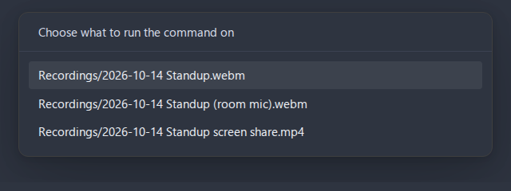

# Command line

The Obsidian desktop app takes commands from a terminal, and Advanced Audio Recorder answers one for everything it does: recording, the actions on a recording, transcript edits, playback, markers, the transcription queue, the recording panel and the marker search. A script can record a meeting, transcribe it into its note, name the speakers, chapter it and split it without a click in the app. Nothing on this page exists on mobile, where the app has no command line.

- [Turning the command line on](#turning-the-command-line-on)
- [One action, three places](#one-action-three-places)
- [How a command is written](#how-a-command-is-written)
- [What the answers look like](#what-the-answers-look-like)
- [Which recording a command acts on](#which-recording-a-command-acts-on)
- [What a command answers](#what-a-command-answers)
- [Running a dialog instead](#running-a-dialog-instead)
- [The recorder](#the-recorder)
- [A recording](#a-recording)
- [Transcribing](#transcribing)
- [Speakers](#speakers)
- [Chapters](#chapters)
- [Transcript lines](#transcript-lines)
- [Playback](#playback)
- [Markers and links at a time](#markers-and-links-at-a-time)
- [Folders and the transcription queue](#folders-and-the-transcription-queue)
- [Searching markers](#searching-markers)
- [The recording panel](#the-recording-panel)
- [Release notes](#release-notes)
- [Obsidian's own commands alongside](#obsidians-own-commands-alongside)
- [A meeting from a script](#a-meeting-from-a-script)
- [More scripts](#more-scripts)

## Turning the command line on

The command line is Obsidian's own, and the plugin only adds commands to it. Turn it on under **Settings > General > Command line interface** and follow the prompt that registers the `obsidian` command with the system, as [Obsidian's help](https://obsidian.md/help/cli) describes. Obsidian must be running for a command to reach it, since every command runs inside the app, with the vault, the settings and the API keys the app already has.

A command acts on the vault the terminal's working directory is in, or else on the vault active in the app. Name another one with `vault=` as the first parameter:

```bash
obsidian vault=Work advanced-audio-recorder
```

Then list what the plugin answers, with one line of help per command:

```bash
obsidian help
```

## One action, three places

Every action of the plugin is defined once and offered in three places at the same time:

- the **command palette**, where it can be given a hotkey under **Settings > Hotkeys**,
- the **context menu** it belongs to: the file menu, the editor menu, the player's menu or a folder's menu,
- the **command line**, as `advanced-audio-recorder:<name>`.

An action added to the plugin appears in all three, so the three never drift apart. The command line's names are short and stable, and the table below pairs each with its palette command.

| Command line         | Command palette                                  |
| -------------------- | ------------------------------------------------ |
| `toggle-recording`   | Start/stop recording                             |
| `quick-note`         | Start/stop quick note                            |
| `pause`              | Pause/resume recording                           |
| `recording-marker`   | Add marker/chapter at current position           |
| `recording-bookmark` | Add bookmark at current recording position       |
| `recording-chapter`  | Add chapter at current recording position        |
| `device`             | Select audio input device                        |
| `info`               | Audio file info                                  |
| `convert`            | Convert audio format                             |
| `split`              | Split audio into parts                           |
| `cleanup`            | Clean up audio                                   |
| `transcribe`         | Transcribe audio                                 |
| `retry-failed`       | Transcribe the parts that failed                 |
| `speakers`           | Rename speakers                                  |
| `chapters`           | Generate chapters from transcript                |
| `export-chapters`    | Export chapters and markers                      |
| `delete`             | Delete recording                                 |
| `delete-with-links`  | Delete recording & link to file                  |
| `split-line`         | Split selection into another speaker             |
| `merge-lines`        | Merge selected lines into one                    |
| `play-pause`         | Play/pause playback                              |
| `stop-playback`      | Stop playback                                    |
| `skip-back`          | Skip playback back                               |
| `skip-forward`       | Skip playback forward                            |
| `mute`               | Mute/unmute playback                             |
| `speed-up`           | Increase playback speed                          |
| `slow-down`          | Decrease playback speed                          |
| `previous-chapter`   | Go to previous chapter                           |
| `next-chapter`       | Go to next chapter                               |
| `loop-chapter`       | Repeat current chapter                           |
| `add-bookmark`       | Add bookmark at current playback position        |
| `add-chapter`        | Add chapter at current playback position         |
| `timestamp-link`     | Copy timestamp link at current playback position |
| `transcribe-folder`  | Transcribe every recording in a folder           |
| `markers`            | Search markers and chapters                      |
| `queue`              | Show the transcription queue                     |
| `panel`              | Open the recording panel                         |
| `whats-new`          | Show what's new                                  |

Three commands exist only on the command line, because the palette already has a toggle for them: `advanced-audio-recorder` on its own reports what the recorder is doing and what is playing, `advanced-audio-recorder:record` starts a recording and `advanced-audio-recorder:stop` stops it.

A recording is [saved in the background](recording.md#recording-again-while-the-last-one-saves), so `stop` answers as soon as the capture has ended and the save is queued, which is all a script that starts the next recording needs. With `wait` it answers once the file is written, or with why the save failed, which is what a script that goes on to read the file needs. The state line counts the saves still running, for example after a `stop` without `wait`:

```text
Idle. A recording started now is saved as WEBM. One stopped recording is still being saved.
```

```bash
obsidian advanced-audio-recorder:stop wait
```

In the palette, an action on a recording acts on the active audio file, or on the recordings the active note embeds or links: the one under the cursor when the cursor is on its link, otherwise every recording of the note, in the order the note mentions them. When that is more than one, the palette asks which, in a picker you can type into, the way Obsidian's own **Move file to...** asks for a folder.



The palette decides whether to show a command each time it opens, for every command of every plugin, so that check has to be cheap. An action on a recording reads only what is active: the open file, the line under the cursor and the note's links from Obsidian's metadata cache, with nothing read from disk. **Transcribe every recording in a folder** is the one action whose targets take a pass over the whole vault to find, so the palette shows it from the settings alone and lists the folders only once the command is chosen. In a vault where no folder holds a recording, the command then says it has nothing to run on.

## How a command is written

A command follows Obsidian's own syntax: the command, then parameters as `name=value` and flags as bare words. Quote a value that holds spaces.

```bash
obsidian advanced-audio-recorder:transcribe file="2026-10-14 Standup" language=de wait
```

Parameters whose value is a choice name the choices in the reference below, for example `destination=note|file|both|link`. Switches take `on` or `off`. A time is seconds, `m:ss` or `h:mm:ss`. A value the command does not accept is refused with the values it does, and nothing runs.

A name is resolved the way Obsidian resolves it. `path=` takes a vault path, and a leading or trailing slash or a Windows backslash is fine, so `path=/Recordings/standup.webm` and `folder=Recordings/` both work. `file=` takes what a wikilink would take, and a heading or a moment after `#` is dropped to find the file, so `file="standup#t=90"` names `standup.webm`. Obsidian's own `--copy` works on every command and puts its answer on the clipboard.

## What the answers look like

Every answer is plain text on standard output, ready for a pipe. The lines below are what the commands print, as their tests pin them, with the names of an example vault.

`advanced-audio-recorder` on its own, with nothing recording, and the same after `record`:

```text
Idle. A recording started now is saved as WEBM.
```

```text
Recording.
```

`stop` with nothing recording:

```text
Nothing is recording.
```

`speakers file=standup` without `map`, listing the roster and how to rename it:

```text
Speaker 1: Ann
Speaker 2: (no name)
Rename with map="<label>=<name>; <label>=<name>".
```

`markers query=budget`, one marker per line, tab-separated: the link target, the time, the kind, the label and, when it has one, the note:

```text
Recordings/standup.webm#t=75	1:15	chapter	Budget
```

`queue` on an empty queue, and `transcribe ... wait` once the run is over:

```text
The transcription queue is empty.
```

```text
Transcribed Recordings/standup.webm into Meetings/standup.md.
```

A refusal says what to change and runs nothing:

```text
format=pdf is not one of: list, cue, outline.
```

## Which recording a command acts on

The commands on a recording take the target the way Obsidian's own commands take a file:

| Parameter           | What it names                                                                                         |
| ------------------- | ----------------------------------------------------------------------------------------------------- |
| `file=<name>`       | A recording or a note, resolved the way a wikilink is, so `file=standup` finds `Meetings/standup.md`. |
| `path=<vault path>` | A recording or a note by its exact path from the vault root.                                          |
| neither             | The file active in Obsidian.                                                                          |
| `recording=<name>`  | Which recording of the note, when it links several: its name, file name, path or link text.           |
| `all`               | Every recording the note links, one after another.                                                    |
| `note=<name>`       | The note a recording belongs to, when `file` or `path` names the recording itself.                    |

A note stands for the recordings it embeds or links, in the order they appear in it, a property such as `audio: "[[standup.webm]]"` counting as a link at its top. A note with one recording needs nothing more, while a note with several answers with their list and asks for `recording=` or `all`.

Naming the note matters for the commands that write into one: `transcribe` inserts the transcript into the note named and no other, `cleanup` links the cleaned copy there, and `delete-with-links` removes the links from it. With neither `file=` nor `path=`, a command acts on the file active in Obsidian, as Obsidian's own commands do, and when that is a note, it is the note named. A recording named on its own is never given the note that happens to be open: with no note named, a transcript is written as a file next to the recording. A note named with `note=` beside a recording must link it, so a typo cannot send a transcript, or a removal of links, to another note.

## What a command answers

Every command answers with text the terminal prints: what it did, or why it did nothing. A command run on several recordings answers one line per recording. What a dialog would have shown as a notice along the way, for example that a converted file already existed, is part of the answer, and is also shown as a notice in the app, for whoever is watching it.

A refusal says what to change: `Meetings/standup.md links 2 recordings: Recordings/a.webm, Recordings/b.webm. Name one with recording=<name>, or add all to run on each.`, `Transcription is switched off in settings.`, `kind=note is not one of: bookmark, chapter.`.

## Running a dialog instead

Every command whose action opens a dialog in the app also takes the `dialog` flag. With it, the command opens that dialog in Obsidian on the recording it names and answers at once, so the choices are made in the app. A dialog opens on one recording, so `dialog` is refused together with `all`, and a dialog for a recording named without its note writes into no note, as the command itself would:

```bash
obsidian advanced-audio-recorder:convert file=standup.webm dialog
```

## The recorder

| Command              | What it does                                                                                      | Parameters                                  |
| -------------------- | ------------------------------------------------------------------------------------------------- | ------------------------------------------- |
| (none)               | Reports what the recorder is doing, the format a recording started now uses, and what is playing. | -                                           |
| `record`             | Starts a recording with the configured input and format.                                          | -                                           |
| `stop`               | Stops the recording in progress and saves it.                                                     | -                                           |
| `toggle-recording`   | Starts a recording, or stops the one in progress.                                                 | -                                           |
| `pause`              | Pauses the recording in progress, or resumes it.                                                  | -                                           |
| `quick-note`         | Starts dictating into the active note, or stops and inserts the text.                             | -                                           |
| `recording-marker`   | Marks the current moment of the recording in progress.                                            | `kind=bookmark\|chapter`, `label=<text>`    |
| `recording-bookmark` | Adds a bookmark at the current moment.                                                            | `label=<text>`                              |
| `recording-chapter`  | Starts a chapter at the current moment.                                                           | `label=<text>`                              |
| `device`             | Lists the audio inputs, the chosen one marked with `*`, or chooses one.                           | `id=<device id>`, `name=<part of its name>` |

A marker without `label` is numbered, as the naming dialog would number it, and `recording-marker` without `kind` drops the kind used last.

One session the command line cannot start is one that records this computer's own output, whether that is **Include system audio** under [Audio input](settings-reference.md#audio-input) or a track whose **Track N source** is **System audio (this computer)**. The host grants that capture only in answer to a user action in a focused Obsidian window, and a command typed in a terminal is neither, so `record` answers with the reason and starts nothing. Start such a recording from the ribbon icon, the command palette or a hotkey. A track recording a loopback **input device** has no such restriction - see [Recording a call with its remote participants](use-cases/meeting-notes-workflow.md#recording-a-call-with-its-remote-participants).

## A recording

Each of these takes the target parameters described [above](#which-recording-a-command-acts-on). What the dialog offers, the command takes as parameters, and whatever is not given comes from the settings, as the dialog's starting values do. The command runs the job in Obsidian and answers when it is done.

| Command             | What it does                                                                | Parameters                                                                                                                                                     |
| ------------------- | --------------------------------------------------------------------------- | -------------------------------------------------------------------------------------------------------------------------------------------------------------- |
| `info`              | Reports the recording's container, codec, duration, bitrate and channels.   | `format=md\|json`                                                                                                                                              |
| `convert`           | Converts the recording to another format.                                   | `to=<format>`, `channels=source\|mono-mix\|mono-left\|mono-right`, `bitrate=<kbps>`, `source=keep\|delete`, `links=none\|replace\|after`                       |
| `split`             | Splits the recording into parts of a fixed length, or at its chapters.      | `by=duration\|chapters`, `minutes=<1-180>`, `suffix=<suffix>`, `bitrate=<kbps>`, `source=keep\|delete`, `links=none\|replace\|after`                           |
| `cleanup`           | Writes a cleaned-up WAV copy: high-pass, noise gate, leveling.              | `highpass=<20-300>\|on\|off`, `gate=<-80 to -20>\|on\|off`, `level=<0-24>\|on\|off`, `channels=source\|mono-mix\|mono-left\|mono-right`, `source=keep\|delete` |
| `export-chapters`   | Writes the chapters and markers as a list, a cue sheet or an outline.       | `format=list\|cue\|outline`, `print`                                                                                                                           |
| `delete`            | Moves the recording to the trash.                                           | -                                                                                                                                                              |
| `delete-with-links` | Moves the recording to the trash and removes its links from the note named. | -                                                                                                                                                              |

`export-chapters` writes the list or the cue sheet next to the recording, or prints it with `print`. The outline is a Markdown list of timecode links, which belongs in a note, so it is always printed - pipe it into Obsidian's `append` to add it to one.

`delete` trashes a recording named on its own, with `path=` or `file=`. A recording named through a note is refused, since the note's links to it would be left broken, and `delete-with-links` is the command for it. `delete-with-links` removes the links that point at the whole recording, while a timecode link such as `[[standup.webm#t=90]]` points at a moment of it and is kept. It needs the note: name it with `file=<note>`, or `note=<note>` beside `path=<recording>`.

`convert` and `split` refuse a format the device cannot encode, `cleanup` refuses a run that would change nothing, and each answers with what it wrote. A conversion or a split can run for minutes, and the terminal cannot interrupt it, because Obsidian hands a command nothing to stop it with. While it runs, the app shows its progress in a notice with a **Cancel**, the same notice a closed conversion or split dialog leaves. A cancelled job leaves the vault as it found it, and the command answers `Conversion of Recordings/standup.webm was cancelled in Obsidian.` or `Split of Recordings/standup.webm was cancelled in Obsidian.` `cleanup source=delete` needs a note that embeds the recording: the cleaned copy takes the place of those embeds, and only then is the recording trashed. A note that only links it, or links moments of it, is refused.

## Transcribing

```bash
obsidian advanced-audio-recorder:transcribe file=standup
```

The command runs the same transcription the transcribe dialog runs, with the same choices, without opening the dialog. Transcription is a paid job that can run for minutes, and the terminal cannot interrupt a command, so while it runs the app shows its progress in a notice with a **Cancel**, as it does for a conversion or a split. The chapters the run is set to generate follow it, what it cost joins the session total, and the app says so in a notice, as it says when a run failed or was cancelled. The command answers at once that the run was started. With `wait` it answers once the run is over, with where the transcript went, which is what a script that goes on to read the transcript needs. With `dialog` it opens the transcribe dialog on the recording instead, so the choices are made in the app.

| Parameter                                                                                      | What it sets for this run                                                           |
| ---------------------------------------------------------------------------------------------- | ----------------------------------------------------------------------------------- |
| `language=<codes>`                                                                             | The language, `auto`, or several codes separated by commas, such as `pl,uk`.        |
| `engine=whisper-api\|deepgram\|gemini\|voxtral\|local-whisper`                                 | The transcription engine.                                                           |
| `destination=note\|file\|both\|link`                                                           | Where the transcript goes.                                                          |
| `format=json\|srt\|vtt\|txt`                                                                   | The format of the transcript file.                                                  |
| `task=cleanup\|summary\|custom\|translate`                                                     | The LLM post-processing task.                                                       |
| `diarize`, `words`, `advanced`, `twopass`, `timestamps`, `speakers`, `postprocess`, `chapters` | The dialog's switches, each `on` or `off`.                                          |
| `participants=<profile>`, `dictionary=<profile>`, `guidance=<profile>`                         | A profile by name, or `none`. Kept as the next default, as a pick in the dialog is. |
| `wait`                                                                                         | Answer when the run is over.                                                        |

The choices apply to this run only and leave the settings as they are, except a profile picked, which the dialog keeps as the default too. Before the run starts, the command checks it could work: a missing API key or an engine this device cannot run is answered with the reason.

The transcript goes into the note the command named - `file=standup` names the note, or `note=` beside the recording - and into no other note. With no note named it is written as a file next to the recording. A run's answer says which: `Transcribed Recordings/standup.webm into Meetings/standup.md.`, and when the engine failed on parts of a long recording, how many, which `retry-failed` transcribes again.

With `all`, the recordings are transcribed one after another, each run finished before the next starts, as if `wait` were given. For many recordings, [`transcribe-folder`](#folders-and-the-transcription-queue) queues them instead.

`retry-failed` transcribes again only the parts the engine failed on, and answers with what it recovered.

## Speakers

```bash
obsidian advanced-audio-recorder:speakers file=standup
obsidian advanced-audio-recorder:speakers file=standup map="Speaker 1=Ann; Speaker 2=Bob"
```

Without `map` the command lists the speakers of the recording, label and name. With it, it names them exactly as the [rename dialog](transcription.md#naming-speakers) would, in every transcript recorded for the recording, and answers with what it rewrote. A speaker the map does not name keeps its name.

| Parameter                   | What it does                                                                                                           |
| --------------------------- | ---------------------------------------------------------------------------------------------------------------------- |
| `map="<label>=<name>; ..."` | The names to give, `;` between them.                                                                                   |
| `merge`                     | Confirms giving two speakers one name, which cannot be undone. Without it such a map is refused with what would merge. |
| `broad`                     | Also rewrites notes that carry no timecode link to the recording.                                                      |
| `undo`                      | Reverts the last rename instead.                                                                                       |
| `profile=<profile>`         | The participant profile the names are added to, or `none`. Defaults to the one the recording was transcribed with.     |

## Chapters

```bash
obsidian advanced-audio-recorder:chapters file=standup
```

`chapters` generates the recording's chapters from its transcript with the LLM, as [Generate chapters from transcript](transcription.md#auto-chapters) does, and answers when they are written. A recording that already has generated chapters is refused unless `replace` is given, and bookmarks and chapters added by hand are kept either way. `profile=<profile>`, `llm=<engine>` and `model=<model>` choose what the dialog's pickers would, and are kept as the defaults, as there.

## Transcript lines

The two [transcript edits](transcription.md#splitting-a-line-between-speakers) work on lines of a note the transcription wrote, named by their numbers as the editor numbers lines, and with `file=` or `path=` naming the note.

| Command       | What it does                                                    | Parameters                                                                                                |
| ------------- | --------------------------------------------------------------- | --------------------------------------------------------------------------------------------------------- |
| `split-line`  | Gives words of one line to another speaker, splitting the line. | `line=<n>`, `text=<words>`, `speaker=<name>\|new`, `rest=<name>\|new\|none`, `start=<m:ss>`, `end=<m:ss>` |
| `merge-lines` | Merges consecutive lines into one line of one speaker.          | `line=<n>`, `to=<n>`, `speaker=<name>\|new\|none`, `confirm`                                              |

`text` is the words on the line, as the selection in the dialog would be, and without it the whole line is meant. Each speaker parameter starts where the dialog starts: the words go to the first other speaker, the rest of the line keeps its speaker, and a merged line takes the speaker of the first line. A merge of more than two lines needs `confirm`, as the dialog asks before it.

A note open in Obsidian is edited in its editor, by the line numbers the editor shows, including what is not saved yet, and the edit can be undone there. A note that is not open is edited on disk. An edit reads the lines once and writes them back only if they still read the same, so an edit made in the app in the meantime is never overwritten, and the command answers that the lines changed and can be run again.

## Playback

`play-pause`, `stop-playback`, `skip-back`, `skip-forward`, `mute`, `speed-up`, `slow-down`, `previous-chapter`, `next-chapter` and `loop-chapter` act on the recording playing in Obsidian, as their hotkeys do, and answer with what they acted on. With nothing playing, they answer `Nothing is playing in Obsidian.`

## Markers and links at a time

| Command          | What it does                                                           | Parameters                  |
| ---------------- | ---------------------------------------------------------------------- | --------------------------- |
| `add-bookmark`   | Adds a bookmark to a recording at a time.                              | `at=<time>`, `label=<text>` |
| `add-chapter`    | Adds a chapter to a recording at a time.                               | `at=<time>`, `label=<text>` |
| `timestamp-link` | Prints a link to a time in a recording, the kind a transcript carries. | `at=<time>`                 |

With a recording named - by `file`, `path`, `recording` or `note` - `at` is required. A time belongs to one recording, so these commands take no `all`: a note that links several is answered with their names, to pick one with `recording=`. With none named, they act on the recording playing in Obsidian, at the playback's position or at `at`. The link `timestamp-link` prints resolves from the note the recording was reached through, so it is ready to paste there, and Obsidian's `--copy` puts it on the clipboard.

## Folders and the transcription queue

```bash
obsidian advanced-audio-recorder:transcribe-folder folder=Recordings/2026 start
obsidian advanced-audio-recorder:queue
```

`transcribe-folder` adds every recording in the folder and its subfolders to the [transcription queue](transcription.md#transcribing-a-folder) and answers how many it added. `folder=/` is the whole vault. With `start` the queue starts transcribing them at once.

`queue` says whether the queue is running, paused or stopped and how many recordings wait, then lists each recording with its state, one per line, tab-separated. `start`, `pause`, `clear` and `remove=<vault path>` do what the queue dialog's buttons do.

## Searching markers

```bash
obsidian advanced-audio-recorder:markers query=budget kind=chapter
```

`markers` lists the markers and chapters of every recording in the vault, or the ones whose label, recording or note contains the words of `query`. Each line is the timecode link's target, the time, the kind, the label and the note, separated by tabs, so a script can cut it apart. `kind=bookmark|chapter` keeps one kind, `limit=<n>` the first ones, and `format=json` answers in JSON.

## The recording panel

`panel` opens the [recording panel](recording-panel.md) in the right sidebar, creating it if it was closed, and answers `Opened the recording panel in Obsidian.` The panel is a view of the app with nothing to print instead, so the command opens it as the palette does, which is useful from a script that has just started a recording and wants its details in view.

## Release notes

`whats-new` prints the release notes the plugin carries, or with `since=<version>` only the releases after that one.

## Obsidian's own commands alongside

The plugin does not repeat what Obsidian's command line already does, and the two work together:

- `obsidian commands filter=advanced-audio-recorder` lists the plugin's palette commands, and `obsidian command id=advanced-audio-recorder:<palette id>` runs one as the palette would, on what is active in the app.
- `obsidian read file=<note>` prints a note the plugin wrote into, such as a transcript.
- `--copy` puts a command's answer on the clipboard.
- `obsidian append file=<note> content="..."` adds a printed outline or link to a note.

## A meeting from a script

A note `Meetings/2026-10-14 Standup.md` embeds the recording of the meeting. One script transcribes it into the note, names the speakers, chapters it, adds the chapter outline to the note and splits the recording at its chapters:

```bash
NOTE="2026-10-14 Standup"
obsidian advanced-audio-recorder:transcribe file="$NOTE" diarize=on wait
obsidian advanced-audio-recorder:speakers file="$NOTE" map="Speaker 1=Ann; Speaker 2=Bob"
obsidian advanced-audio-recorder:chapters file="$NOTE"
obsidian append file="$NOTE" content="$(obsidian advanced-audio-recorder:export-chapters file="$NOTE" format=outline)"
obsidian advanced-audio-recorder:split file="$NOTE" by=chapters
```

Each step answers before the next one starts, and a step that cannot run answers why, so the script can stop there. The [meeting notes workflow](use-cases/meeting-notes-workflow.md) covers the same meeting from the app.

## More scripts

[Script recordings from the terminal](use-cases/scripting-from-the-terminal.md) collects complete scripts for the common jobs: a timed recording, a folder transcribed overnight, a moment found with `jq` and linked, a recording shared as a small MP3, chapters exported as a cue sheet, and a transcript line fixed without opening its note.
