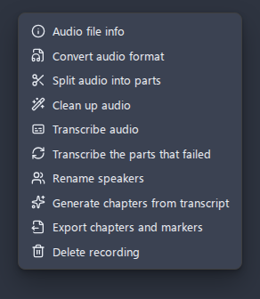
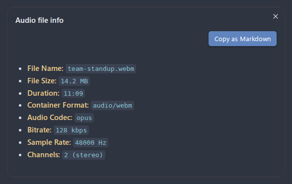
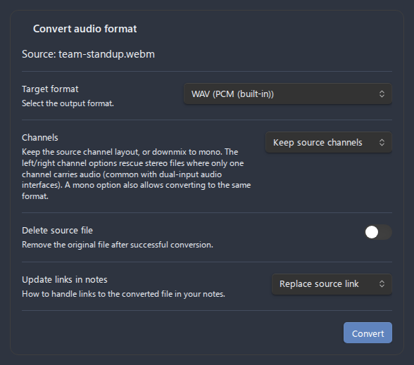
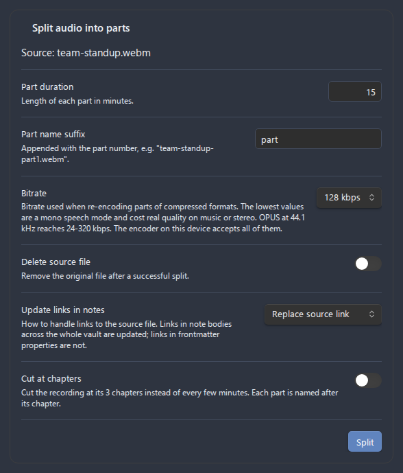
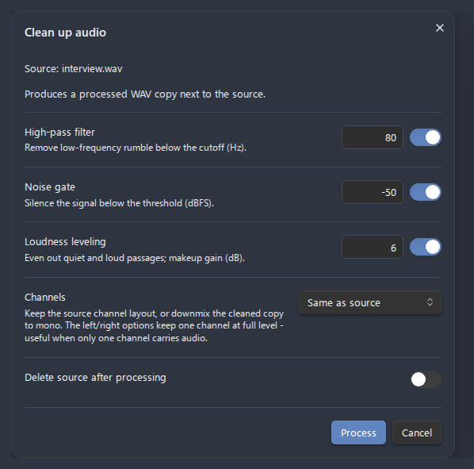
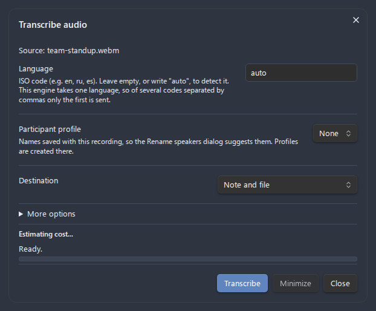

# File operations (context menu)

Advanced Audio Recorder adds a set of actions to Obsidian's right-click menu for audio files. From one place you can inspect a recording's metadata, convert it to another format, split it, clean it up, transcribe it, or delete it - without leaving your vault. This page documents every action, where it appears, and exactly what each one does.

- [Where the menu appears](#where-the-menu-appears)
- [Audio file info](#audio-file-info)
- [Convert audio format](#convert-audio-format)
- [Split audio into parts](#split-audio-into-parts)
- [Clean up audio](#clean-up-audio)
- [Transcribe audio](#transcribe-audio)
- [Delete recording](#delete-recording)
- [All context-menu actions](#all-context-menu-actions)

## Where the menu appears

The plugin adds its actions to the context menu of any audio file. You can open that menu from three places:

- The **File Explorer** - right-click an audio file in the file tree.
- An **embed link** in the editor - right-click an audio link such as `![[recording.webm]]` (both wikilinks `![[…]]` and Markdown links `` are recognized).
- An **embedded audio player** - right-click the player rendered inside a note (the built-in player or the [enhanced player](audio-player.md)).

A **folder** carries one entry of its own rather than the file actions, because it targets no single recording. With transcription enabled, right-clicking a folder offers **Transcribe every recording in this folder**, which sends the whole folder to the [transcription queue](transcription.md).

The plugin recognizes a file as audio by its extension. Supported extensions are `webm`, `ogg`, `wav`, `mp3`, `flac`, `mp4`, `m4a`, and `aac` - see [Formats](formats.md) for what each one is.



Which actions appear depends on where you click and on your settings:

| Action                                | File Explorer | Embed link | Player | Condition                                                 |
| ------------------------------------- | ------------- | ---------- | ------ | --------------------------------------------------------- |
| **Audio file info**                   | Yes           | Yes        | Yes    | Always                                                    |
| **Convert audio format**              | Yes           | Yes        | Yes    | Always                                                    |
| **Split audio into parts**            | Yes           | Yes        | Yes    | Always                                                    |
| **Clean up audio**                    | Yes           | Yes        | Yes    | Always                                                    |
| **Transcribe audio**                  | Yes           | Yes        | Yes    | When transcription is enabled                             |
| **Transcribe the parts that failed**  | Yes           | Yes        | Yes    | When transcription is enabled                             |
| **Rename speakers**                   | Yes           | Yes        | Yes    | When **Rename speakers** is enabled                       |
| **Generate chapters from transcript** | Yes           | Yes        | Yes    | When **Auto chapters** is enabled                         |
| **Export chapters and markers**       | Yes           | Yes        | Yes    | Always                                                    |
| **Delete recording**                  | Yes           | No         | No     | When reached on its own                                   |
| **Delete recording & link to file**   | No            | Yes        | Yes    | When reached through a note or a link, not at a timestamp |

Wherever the recording is reached through a note - its **embed link** in the editor, its **player**, or the palette in that note - plain **Delete recording** is replaced by **Delete recording & link to file**: deleting a file a note links should also clean up the link, rather than leave it broken. The two are never offered together. When you right-click an **enhanced player**, the menu also offers position-aware actions at the clicked point - **Add marker here**, **Add chapter here**, and **Copy timestamp link here** - alongside the file actions above. Those are documented in [Audio player](audio-player.md#markers-and-chapters).

Every action in the table is also a **command palette** command of the same name, so each one can be bound to a hotkey under **Settings > Hotkeys**, and a [command line](command-line.md) command as well. The three are one definition, so an action is never in one place and missing from another. In the palette a command acts on the **active audio file**, or on the recordings the **active note** embeds or links: the one whose link the cursor is on, otherwise every recording of the note. When that is more than one, the command asks which in a picker you can type into. **Delete recording & link to file** is offered from a note: it trashes the recording and removes the link to it under the cursor, or, with the cursor elsewhere, every link to the whole recording in the note. Timecode links to moments of it, such as a transcript's, are left in place. A command is available only while the active file gives it a recording and the action's own condition holds.

---

## Audio file info

**Audio file info** opens a read-only modal that reads the file and reports its technical properties. Use it to confirm what was actually recorded - the container, the codec, the sample rate, and so on - without opening an external tool.



The modal lists the following fields:

| Field                | What it shows                                                                                                    | Example          |
| -------------------- | ---------------------------------------------------------------------------------------------------------------- | ---------------- |
| **File Name**        | The file name with its extension.                                                                                | `recording.webm` |
| **File Size**        | On-disk size, formatted (Bytes / KB / MB / GB).                                                                  | `4.2 MB`         |
| **Duration**         | Length as `m:ss`, or `h:mm:ss` once the recording passes an hour, or `unknown` when no reader could produce one. | `12:34`          |
| **Container Format** | The container's MIME type, as its headers name it.                                                               | `audio/webm`     |
| **Audio Codec**      | The codec of the audio track, as its headers name it.                                                            | `opus`           |
| **Bitrate**          | The audio's own average bitrate, or `unknown` when neither the file nor its length gives one.                    | `128 kbps`       |
| **Sample Rate**      | The sample rate in hertz.                                                                                        | `48000 Hz`       |
| **Channels**         | Channel count with a label (`1 (Mono)`, `2 (Stereo)`).                                                           | `2 (Stereo)`     |

A few notes on how these values are derived:

- **Duration**, **Sample Rate**, and **Channels** are read from the container's own headers, which costs nothing no matter how long the recording is. Only a container the plugin cannot parse at all falls back to decoding the audio with the browser's audio engine.
- **Duration** has one extra step behind it, because a recorder streaming into a container writes no length into a segment it has not finished, which is what the plugin's own recordings look like until they are closed. When the headers carry no length, the plugin asks the browser to read the file the way the player does and report the length it finds, so a live-written recording still shows its real duration.
- **Duration** and **Bitrate** read `unknown` when none of those steps could produce a length. That is deliberate: a recording whose length was never read is not a recording that lasts no time, so the modal says nothing rather than showing a `0:00` that looks like a measurement.
- **Bitrate** is the bitrate of the audio itself, without the container around it or any artwork embedded in it. It is the figure the track declares where the container stores one, which MP4 does, and otherwise it is measured from the sizes of the audio packets, reading their headers only. That measurement covers at most the first thirty thousand packets, about ten minutes of Opus or AAC, so for a longer variable-bitrate recording it is the average of that opening stretch. Where neither is available the modal falls back to the file size divided by the duration.
- **Container Format** and **Audio Codec** are read from the same headers, so a file whose extension does not match its contents, such as Vorbis in a `.webm` or a renamed file, is described as what it really is. The codec is named the way the plugin's audio library names it, which for WAV also gives the sample width: `pcm-s16`, `pcm-s24`, or `pcm-f32`. Only a file that could be read by decoding alone is described by its extension instead: `webm` > `opus`, `ogg` > `opus/vorbis`, `mp4`/`m4a`/`aac` > `aac`, `mp3` > `mp3`, `wav` > `pcm`, `flac` > `flac`.

If the file cannot be decoded (it is empty, corrupted, or in a container the app cannot read), the plugin shows a notice instead of the modal.

### Copy as Markdown

The modal has a **Copy as Markdown** button. Click it to copy all eight fields to the clipboard as a formatted Markdown bullet list, then paste them anywhere. The button briefly changes to **Copied!** to confirm.

This is the fastest way to attach exact file details to a bug report. See the [Bug reporting guide](BUG_REPORTING_GUIDE.md) for what else to include.

The copied text looks like this:

```markdown
- **File Name:** `recording.webm`
- **File Size:** `4.2 MB`
- **Duration:** `12:34`
- **Container Format:** `audio/webm`
- **Audio Codec:** `opus`
- **Bitrate:** `128 kbps`
- **Sample Rate:** `48000 Hz`
- **Channels:** `2 (Stereo)`
```

---

## Convert audio format

**Convert audio format** transcodes the file to a different format. It opens a dialog seeded with your defaults, writes the converted file next to the source, and (optionally) updates the links in your notes and removes the original.



The dialog header shows the source file name. Below it are these controls:

| Control                   | Description                                                                   | Default                                |
| ------------------------- | ----------------------------------------------------------------------------- | -------------------------------------- |
| **Target format**         | The output format (every offline-encodable format except the source).         | First format in list                   |
| **Channels**              | Keep the source channel layout, or downmix to mono.                           | Keep source channels                   |
| **Bitrate**               | Bitrate for lossy targets. Hidden for a WAV or FLAC target, which carry none. | Your **Audio bitrate** setting (`128`) |
| **Delete source file**    | Move the original to the system trash after a successful conversion.          | From settings                          |
| **Update links in notes** | How to rewrite links to the source file in your notes.                        | From settings                          |

Details on the controls:

- **Target format** lists each format with its encoder, e.g. `MP3 (Mediabunny MP3 Encoder)`, `FLAC (Mediabunny FLAC Encoder)`, `OGG (…)`. The source's own format is excluded for channel-preserving conversions, so you always pick a different one, and selecting a mono **Channels** option adds the source's own format back to the list (see below).
- **Channels** offers `Keep source channels`, `Mono (mix all channels)` (the average of every channel - the standard downmix), `Mono (left channel)`, and `Mono (right channel)` (exactly one channel, at full level). The left/right options rescue stereo files where only one channel carries audio - the typical result of recording one microphone through an audio interface whose two mono inputs appear as a single stereo device. See [Recording in mono](recording.md#recording-in-mono) for the capture-time equivalent.
- **Bitrate** offers `24`, `32`, `48`, `64`, `96`, `128`, `160`, `192`, `256`, and `320` kbps, cut to what the chosen target format and this device's encoder can write: picking `MP3` drops everything below `32`, and selecting `WAV` or `FLAC` hides the row entirely, because neither carries a bitrate. The values below `64` are a mono speech mode - see [Bitrate guidance](formats.md#bitrate-guidance).
- **Update links in notes** offers `Do nothing`, `Replace source link`, and `Insert after source link` (see [Link updates and source deletion](#link-updates-and-source-deletion) below).

The **Delete source file** and **Update links in notes** defaults come from **Settings > Advanced Audio Recorder > Output format** (the **Delete source after conversion** and **Update links after conversion** settings). You can override them for a single conversion in the dialog. See [Settings reference](settings-reference.md#output-format) for those settings.

Click **Convert** to run. Progress text appears in the dialog (`Reading source file…`, `Converting… 42%`, `Saving…`, `Updating links…`). When it finishes, a notice reports the new file name (`Converted to …`, or `Replaced with …` when the source was deleted).

A **Cancel** button sits beside **Convert** while the conversion runs, and stops it wherever it is, in the middle of the transcoding included. Closing the dialog does not stop the conversion: it goes on in the background, and a notice keeps showing its progress with a **Cancel** of its own. A cancelled conversion writes no file and leaves your notes and the source untouched, and a notice says it was cancelled. Once the converted file is saved, the conversion goes on to update the links and remove the source as you asked, since stopping halfway through the links would leave notes pointing at both files.

### How conversion works

- The source bytes are read once, then transcoded to the target format through the **streaming Mediabunny pipeline**: the audio is processed in chunks instead of being decoded fully into memory, and it is **always re-encoded at the bitrate you selected** (the conversion never copies packets, so your bitrate choice is always honored).
- If the source container cannot be processed by the streaming pipeline, the plugin **falls back to a full decode and re-encode**, so every supported format keeps working even when its container is not stream-readable.
- **Converting to WAV uses the same streaming pipeline**, so a long recording is written as WAV without first being held in memory as decoded audio, and the WAV keeps the source's own sample rate. Only the full-decode fallback above changes the rate, to the one this device's audio runs at.
- **A compressed target keeps the source's sample rate and channels whenever this device's encoder takes them.** When the encoder refuses the source's rate, the file is written at the nearest standard rate it does take, the lowest one above the source first, and the channel count stays the source's. The AAC encoder of the desktop and Android apps takes only 44.1 and 48 kHz, so a 16 kHz mono recording converted to `M4A` becomes a 44.1 kHz mono file. A notice names the change, for example `"meeting.m4a" was resampled from 16 kHz to 44.1 kHz, because the M4A encoder on this device does not take 16 kHz.`
- A mono **Channels** option downmixes inside the same pipeline: the mix is the plain average of every channel - sample-identical to the [recording-time downmix](recording.md#recording-in-mono) - and the left/right options keep one channel untouched. A right-channel pick on a file that is already mono falls back to the only channel instead of producing silence.
- The converted file is written **next to the source** as `<source-name>.<target-format>`. If a file with that name already exists, the conversion is **aborted** with a notice - choose a different format or rename the existing file.
- A **same-format mono downmix** (for example stereo `WAV` to mono `WAV`) is written as `<source-name>-mono.<format>`, so it never collides with the source. Same-format conversion without a mono option is refused - it would only re-encode the file into itself.

### Link updates and source deletion

When **Update links in notes** is not `Do nothing`, the plugin rewrites links to the source file across the **whole vault**, including notes that are not currently open. Both wikilinks (`![[…]]`) and Markdown links (``) are covered, and the new links follow your link-format preferences.

- `Replace source link` - the link to the old file becomes a link to the converted file.
- `Insert after source link` - the converted file's link is added after the original, leaving the old link in place.

Two things are handled defensively:

- **Frontmatter links are not rewritten** (a YAML property cannot hold several links). When such links exist, the plugin shows a notice telling you how many must be updated by hand.
- **Source deletion waits on links.** If **Delete source file** is on but some links could not be updated, the source file is **kept** so those links do not break, and a notice explains why.

This is the same vault-wide link engine used by [splitting](splitting.md), so the behavior is consistent across both flows.

---

## Split audio into parts

**Split audio into parts** divides a long recording into fixed-duration segments. It opens a dialog with the part duration, a part-name suffix, an optional bitrate (for compressed sources), a **Delete source file** toggle, and the same **Update links in notes** options as conversion.

WAV files are split losslessly at the byte level without re-encoding, while compressed formats are decoded in one pass and each part is re-encoded as it is cut. The parts are written next to the source, and the split aborts if any target part file already exists.

The full reference - duration ranges, naming rules, link handling, and limits - lives in [Splitting](splitting.md).



---

## Clean up audio

**Clean up audio** runs offline DSP over the file to remove background noise and even out loudness, writing a cleaned `…-processed.wav` copy and leaving the original untouched. The dialog lets you toggle three stages - high-pass filter, noise gate, and loudness leveling - seeded from your **Audio cleanup defaults**.

This is post-processing you invoke on demand, and it never changes how live recording works. The complete reference - every stage, its parameters and ranges, recommended settings, and size/length limits - is in [Audio cleanup](audio-cleanup.md).



---

## Transcribe audio

**Transcribe audio** sends the file to your configured transcription engine and writes the result back into the note, a sidecar file, or both. This action only appears in the menu when **Enable transcription** is on in settings.

A progress dialog shows the elapsed timer and lets you **Cancel** or **Minimize** the job to the status bar. The full reference - engines, language, diarization, output formats, and setup - is in [Transcription](transcription.md). For step-by-step provider setup, see the [use-case guides](use-cases/index.md).



---

## Delete recording

Two delete actions hand the file to Obsidian, which disposes of it the way your vault's **Deleted files** preference says: the system trash, the vault's own `.trash` folder, or permanent deletion.

- **Delete recording** - trashes the audio file. Offered where the file is reached on its own: the File Explorer, or the palette with the audio file itself open.
- **Delete recording & link to file** - trashes the audio file **and** removes its link in the same step. Offered where the file is reached through a note: a **link** in the editor or an **embedded player**, where it removes the link at the click, and the palette in a note, where it removes the link under the cursor or, with the cursor elsewhere, every link to the whole file in the note. In Reading view no editor holds the link a player was rendered from, so there every link to the whole file in the note goes instead. Any link to the recording counts, whether it is a wikilink or a Markdown link (including one whose path is written with `%20` for spaces), an embed or a plain link, with or without an alias, except a [timecode link](audio-player.md#timecode-links) such as a transcript's timestamp. A transcript holds dozens of timestamps to the same recording, so deleting the recording from one of them would leave all the others pointing at nothing. Right-clicking a timestamp therefore offers the other file actions, such as **Transcribe audio** or **Convert audio format**, but neither delete. The same holds for a player whose embed starts at a timestamp, and for the palette with the cursor on one.

If a recording has marker or chapter data, its sidecar (`recording.webm.markers.json`) follows the file automatically: it is moved on a rename or move, and on a delete it goes to the same trash as the recording, as set under **Settings > Files and links > Deleted files**. Restore both files from the trash to get the recording back with its markers and speaker names - see [Audio player](audio-player.md#markers-and-chapters).

---

## All context-menu actions

| Action                                   | What it does                                                                            | Where available                                  | Doc                                                                 |
| ---------------------------------------- | --------------------------------------------------------------------------------------- | ------------------------------------------------ | ------------------------------------------------------------------- |
| **Audio file info**                      | Shows file metadata in a modal with a Copy as Markdown button.                          | File Explorer, embed link, player                | [This page](#audio-file-info)                                       |
| **Convert audio format**                 | Transcodes the file to another format and can update links and delete the source.       | File Explorer, embed link, player                | [This page](#convert-audio-format)                                  |
| **Split audio into parts**               | Splits the file into fixed-duration parts and can update links and delete the source.   | File Explorer, embed link, player                | [Splitting](splitting.md)                                           |
| **Clean up audio**                       | Runs offline DSP (high-pass, noise gate, leveling) and writes a cleaned WAV copy.       | File Explorer, embed link, player                | [Audio cleanup](audio-cleanup.md)                                   |
| **Transcribe audio**                     | Transcribes the file with your configured engine.                                       | File Explorer, embed link, player (if on)        | [Transcription](transcription.md)                                   |
| **Transcribe the parts that failed**     | Retries only the parts of a long recording whose transcription failed.                  | File Explorer, embed link, player (if on)        | [Transcription](transcription.md)                                   |
| **Rename speakers**                      | Replaces diarized labels with participant names in an existing transcript.              | File Explorer, embed link, player (if on)        | [Transcription](transcription.md#naming-speakers)                   |
| **Split selection into another speaker** | Gives the selected words of a transcript line to another speaker and fixes their times. | Editor menu on a selection in a transcript line  | [Transcription](transcription.md#splitting-a-line-between-speakers) |
| **Merge selected lines into one**        | Joins consecutive transcript lines into one line of one speaker.                        | Editor menu on a selection over transcript lines | [Transcription](transcription.md#merging-lines-into-one)            |
| **Generate chapters from transcript**    | Asks the configured LLM to divide the transcript into titled chapters.                  | File Explorer, embed link, player (if on)        | [Transcription](transcription.md)                                   |
| **Export chapters and markers**          | Writes the markup as a timecoded list, a cue sheet, or a Markdown outline.              | File Explorer, embed link, player                | [Audio player](audio-player.md#exporting-chapters-and-markers)      |
| **Delete recording**                     | Hands the audio file to Obsidian's own Deleted files handling.                          | File Explorer                                    | [This page](#delete-recording)                                      |
| **Delete recording & link to file**      | Trashes the audio file and removes its embed link from the editor.                      | Embed link, player (not on a timestamp link)     | [This page](#delete-recording)                                      |
| **Add marker here**                      | Adds a bookmark at the clicked point on the seek bar.                                   | Enhanced player (markers on, editing)            | [Audio player](audio-player.md#markers-and-chapters)                |
| **Add chapter here**                     | Adds a chapter at the clicked point on the seek bar.                                    | Enhanced player (markers on, editing)            | [Audio player](audio-player.md#markers-and-chapters)                |
| **Copy timestamp link here**             | Copies a link to the clicked position, e.g. `[[recording#t=90\|1:30]]`.                 | Enhanced player                                  | [Audio player](audio-player.md#timecode-links)                      |

See also: [Features](features.md) for the full feature list, [Settings reference](settings-reference.md) for the defaults these dialogs seed from, and [Troubleshooting](troubleshooting.md) if a conversion or cleanup fails.
