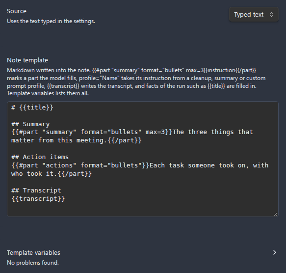
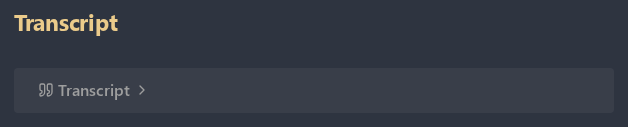
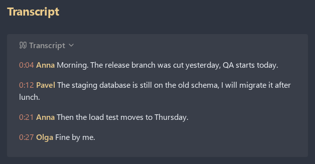
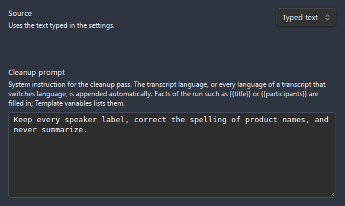
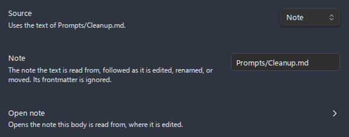
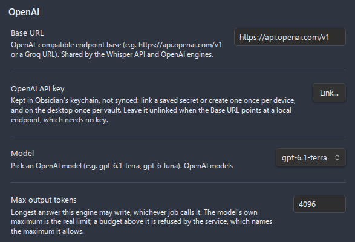
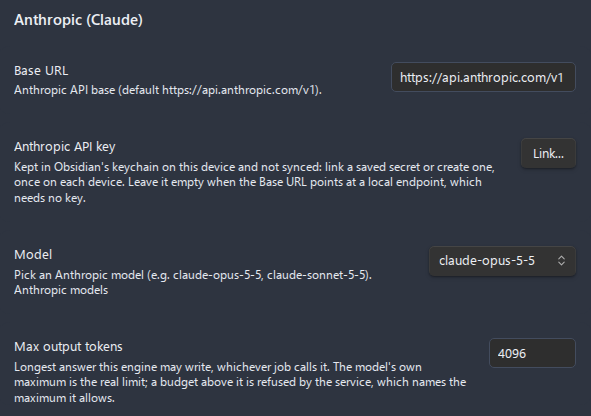

# LLM post-processing

**LLM post-processing** is an optional step that passes a finished transcript through a large language model (LLM) before it is written to your note or sidecar file. Use it to **clean up** the raw machine transcript, **summarize** it into key points and action items, **translate** it into another language, apply your own **custom** instruction, or **structure** the note with a template whose sections the model fills. It is part of the transcription pipeline: it only runs when transcription runs, after the speech-to-text engine produces the transcript and before the output is saved.

- [What it does and when it runs](#what-it-does-and-when-it-runs)
- [Enabling it](#enabling-it)
- [The five tasks](#the-five-tasks)
    - [Clean up](#clean-up)
    - [Summarize](#summarize)
    - [Translate](#translate)
    - [Custom](#custom)
    - [Structure with a template](#structure-with-a-template)
- [Prompt profiles](#prompt-profiles)
- [Default prompts](#default-prompts)
- [Providers and models](#providers-and-models)
- [Shared API keys](#shared-api-keys)
- [Base URL](#base-url)
- [Max output tokens](#max-output-tokens)
    - [How large to set it](#how-large-to-set-it)
- [Worked examples](#worked-examples)
- [Behavior and reliability](#behavior-and-reliability)
- [Settings summary](#settings-summary)
- [Related pages](#related-pages)

## What it does and when it runs

When **Enable LLM post-processing** is on, the plugin runs the LLM pass at the very end of a [transcription](transcription.md):

1. The speech-to-text **engine** transcribes the audio into a transcript (segments, timestamps, and - when [diarization](transcription.md#speakers-and-diarization) is in effect - speaker labels).
2. The transcript is rendered to Markdown using your [transcript output](transcription.md#output-where-the-transcript-goes) settings.
3. **LLM post-processing runs** on that result - the status bar and progress dialog show `Post-processing with LLM...`.
4. The processed text is written to your note and/or sidecar file according to **Destination**.

It changes the **text** of the transcript, not the audio. It runs on every transcription while it is enabled - automatic [transcribe-after-recording](use-cases/transcribe-after-recording.md) runs, the **Transcribe audio** command, and the right-click **Transcribe audio** action all go through the same step.

> **It is a separate, paid API call.** The cloud providers (OpenAI, Anthropic, Google Gemini, Mistral, DeepSeek) bill for the tokens this step uses, on top of the transcription engine's cost. The local whisper.cpp transcription engine is offline, but LLM post-processing always uses one of the five cloud LLM providers, so the text of the transcript is sent to that provider's servers.

---

## Enabling it

LLM post-processing has a block of its own in the transcription settings, below **Transcript output** and **Auto chapters** and above **Advanced**.

1. Open **Settings > Advanced Audio Recorder**.
2. Turn on **Enable transcription** (the whole **Transcription** section only appears when it is on).
3. Scroll to the **LLM post-processing** heading.
4. Turn on **Enable LLM post-processing**. The task, its prompt profiles, provider, key, model, and token controls appear below it.

If transcription itself is off, there is nothing for this step to process, so the option is hidden.

---

## The five tasks

Pick what the LLM should do with the transcript from the **Task** dropdown.

| Task                          | What it does                                                                                                                                                 | What it preserves                                                                |
| ----------------------------- | ------------------------------------------------------------------------------------------------------------------------------------------------------------ | -------------------------------------------------------------------------------- |
| **Clean up**                  | Fixes punctuation, capitalization, and obvious speech-to-text errors; adds paragraph breaks; trims filler artifacts.                                         | The speaker's exact wording and meaning, plus any speaker labels and timestamps. |
| **Summarize**                 | Condenses the transcript into key points and action items as Markdown bullet lists under short headings.                                                     | Both: the summary is added **above** the full transcript, which is kept intact.  |
| **Translate**                 | Writes the transcript in another language, one line per spoken segment.                                                                                      | Both: the translation is written **beside** the original, with the same timings. |
| **Custom**                    | Sends your own instruction to the LLM, verbatim, and uses the model's reply as the transcript body.                                                          | Whatever your instruction tells it to preserve.                                  |
| **Structure with a template** | Writes the note from a note template: the model fills its parts, such as a summary or action items, and the plugin writes them into the template's sections. | The transcript, wherever the template writes `{{transcript}}`.                   |

### Clean up

The default task. The LLM is asked to act as a transcription editor: correct punctuation, capitalization, and obvious recognition errors, insert sensible paragraph breaks, and remove filler artifacts that add no meaning - **without** summarizing, translating, paraphrasing, adding, or omitting content. Speaker labels and timestamps are kept exactly as they appear, each on its original line. The cleaned text **replaces** the raw transcript body in your output.

### Summarize

The LLM is asked to act as an analyst and produce a concise set of key points and action items as Markdown bullet lists under short headings, faithful to the content and inventing nothing. Unlike the other two tasks, summarize **does not replace** the transcript: the output is written as a `### Summary` section, followed by a `### Transcript` section that contains the full transcript unchanged. The summary is generated from the plain transcript text (timestamps and player links are not fed to the model), so you get a clean prose summary plus the complete transcript underneath.

### Translate

The transcript is translated into the language named in **Translate into** (English when the field is empty). Like summarize, translation **does not replace** the transcript: the original is kept and the translation is written beside it. With a file destination that means **two files**, the second one naming its language (`recording.Spanish.srt`); in a note the translation follows the original under a heading of its language.

The pass runs over the transcript's **segments**, not over the rendered text. Each segment is sent as one numbered line carrying its speaker, and the answer is mapped back onto the segment its number names. The start, end, and speaker of every segment are held by the plugin throughout and re-attached unchanged, so the translation carries the recording's own timeline whatever the model returns. That is what makes **SubRip and WebVTT come out translated** with no further work, and their timecodes identical to the original's.

A long transcript is translated in **several calls**, sized so the answer fits the model's output ceiling rather than being cut off at it. A call whose answer does not line up, one line short or one line too many, is asked again once; if it still does not line up, those segments keep their original text. A partly translated transcript with correct timings is worth more than one whose lines have slipped against the clock.

Translation is a separate thing from the engine's own [speech translation](transcription.md): that one happens during recognition, only ever writes English, and is offered only where the engine has an operation for it. This one runs afterwards, on the finished transcript, into any language, on any engine.

### Custom

Your **Custom instruction** is sent to the model **verbatim** as the system prompt - no language clause and no wording are added, and only the facts of the run it names in double braces are filled in (see [Facts of the run in a prompt](#facts-of-the-run-in-a-prompt)). The model's reply **replaces** the transcript body. This is the most flexible task and the one where you are fully responsible for the result: if you want the output in a specific language, format, or structure, say so in the instruction.

### Structure with a template

The note is written from the selected **note template profile**: Markdown of your own with **parts** the model fills from the transcript. A part is a block standing where its result goes, and its body is the instruction for it:



```handlebars
#
{{title}}

{{date recordedAt format='dddd, D MMMM YYYY'}}
·
{{duration}}

## Summary

{{#part 'summary' format='bullets' max=3}}
	The three things that matter from this meeting, most important first.
{{/part}}

## Action items

{{part 'actions' profile='Action items'}}

## Blockers

{{#part 'blockers' format='bullets'}}
	What stops a participant from moving on, and who is blocked.
{{/part}}

{{transcript}}
```

Every part of a template is asked for in **one call**: the model reads the transcript once and answers every part, which is cheaper and more consistent than a call per part. The model answers with data, never with Markdown, and the plugin writes the Markdown, so a list cannot come back broken. A part with `separate=true` is asked for in a call of its own, for a part whose instruction would crowd the others.

| Setting of a part        | What it does                                                                                                                                                                                                        |
| ------------------------ | ------------------------------------------------------------------------------------------------------------------------------------------------------------------------------------------------------------------- |
| `format="..."`           | What the part is, from the formats below; `prose` when none is named.                                                                                                                                               |
| `max=5`                  | Most items a list keeps. The model is asked for no more, and the plugin cuts the list there.                                                                                                                        |
| `empty="remove"`         | What a part the model found nothing for does: `remove` (the default) drops it with the heading right above it, `keep` leaves the section empty, any other text is written instead.                                  |
| `profile="Action items"` | Takes the instruction from a cleanup, summary, or custom prompt profile of that name, looked up in that order, so one instruction serves every template. A part names a profile or writes an instruction, not both. |
| `language="German"`      | Writes this part in another language than the rest.                                                                                                                                                                 |
| `separate=true`          | Asks for the part in a call of its own.                                                                                                                                                                             |

The formats:

| Format      | What it writes                                                                                                            | Its own settings                                                                                                        |
| ----------- | ------------------------------------------------------------------------------------------------------------------------- | ----------------------------------------------------------------------------------------------------------------------- |
| `prose`     | Paragraphs of text.                                                                                                       |                                                                                                                         |
| `bullets`   | A bulleted list.                                                                                                          |                                                                                                                         |
| `numbered`  | A numbered list, for steps in order.                                                                                      |                                                                                                                         |
| `tasks`     | A checklist of action items with who does each and by when: `- [ ] Send the deck (Ben, due 2026-10-01)`.                  | `style="dataview"` writes `[owner:: Ben] [due:: 2026-10-01]`, `style="tasks"` writes the Tasks plugin's `📅 2026-10-01` |
| `decisions` | Decisions, each with its reason: `- **Ship Friday**: QA is done`.                                                         |                                                                                                                         |
| `terms`     | A glossary of the names and terms used, each with its meaning.                                                            |                                                                                                                         |
| `outline`   | The topics discussed, each with its points nested under it.                                                               |                                                                                                                         |
| `quotes`    | Quotes as said, each in a quote block with who said it and a link to the moment in the recording, which the player opens. |                                                                                                                         |
| `table`     | A table with the columns the part names.                                                                                  | `columns="Owner, Task, Due"`, required                                                                                  |
| `callout`   | Paragraphs in a callout.                                                                                                  | `type="tip"`, `title="Key points"`, `folded=true`                                                                       |

Whatever the model writes, a `[[link]]` in it is written as text, so a model never links a note or creates one, and a `|` or a line break cannot break a table row. A due date that is not a calendar date (`next week`) is left out rather than written where Dataview or Tasks would misread it.

The instruction of a part, and the profile it names, can use every [fact of the run](#facts-of-the-run-in-a-prompt), so it can name the meeting and its people. A template can use them too, and also `{{transcript}}`, the transcript as the note would write it, and `{{parts.summary}}`, the result of a part, for example in `{{#if parts.actions}}...{{/if}}`. A part inside a condition is asked for only when the condition holds. The model is told the title, date, length and participants of the recording, the terms of the dictionary profile in use, and to write in the transcript's language.

#### The transcript in a template

`{{transcript}}` writes the transcript the way your [transcript output](transcription.md#output-where-the-transcript-goes) settings write it. Its settings change that for this template only:

| Setting                              | What it does                                                                                 |
| ------------------------------------ | -------------------------------------------------------------------------------------------- |
| `callout="quote"`                    | Puts the whole transcript in a callout of that type; `callout=true` uses a `note` callout.   |
| `title="Transcript"`, `folded=true`  | The callout's title, and whether it starts closed (`true`) or open (`false`).                |
| `timestamps=false`, `speakers=false` | Leaves the timestamp or the speaker off every line; `true` writes them whatever the setting. |

```handlebars
{{transcript callout='quote' title='Transcript' folded=true}}
```

A long meeting then stays one line on the screen until you open it, below the summary instead of pushing it away. Renaming a speaker later still finds the lines inside the callout, and the timestamps the template chose are recorded with the note, so a rename reads the lines the way they were written.





To write the turns in a shape of your own, repeat a block over `turns`: each turn has `speaker`, `start` (seconds), `time` (`1:05`), `link` (a link to that moment of the recording) and `text`, with consecutive lines of one speaker merged as your settings merge them.

```handlebars
{{#each turns}}
	-
	{{link}}
	**{{speaker}}**:
	{{text}}
{{/each}}
```

The transcript is written once: a template that writes `{{transcript}}` twice, or inside a repeat, is shown as an error.

A template is applied as best it can be:

- **A call that fails costs only its own parts.** They come out empty, the rest of the note is written, and a notice names the parts that are missing. Only when every call fails is the pass a failure, and the plain transcript is kept as for any task.
- **A part naming a profile that does not exist** is left out, and a notice names the profile.
- **A template that cannot be rendered**, such as one with two parts of the same name, keeps the plain transcript, with a notice naming the problem.
- **With no template selected**, the transcript is kept as it is, with a notice.

The **Template variables** row on a template's page checks it as you type: a part without a name or an instruction, an unknown format or setting, a part inside a repeat, a profile no prompt profile is called, `{{parts.name}}` naming no part, and a transcript written twice or with a setting it does not take. The cost estimate before a run counts the calls the selected template makes.

---

## Prompt profiles

Each task has its own catalogue of named prompts, shown below the **Task** dropdown. The catalogue that appears is the one belonging to the selected task:

| Task                          | Catalogue shown                 | Language handling                                                                                                                                            |
| ----------------------------- | ------------------------------- | ------------------------------------------------------------------------------------------------------------------------------------------------------------ |
| **Clean up**                  | **Cleanup prompt profiles**     | The transcript language is **appended automatically** at request time, or every language of a transcript that switches language. You do not add it yourself. |
| **Summarize**                 | **Summary prompt profiles**     | The transcript language is **appended automatically** at request time - you do not add it yourself.                                                          |
| **Translate**                 | **Translation prompt profiles** | The **Translate into** language is **appended automatically** at request time.                                                                               |
| **Custom**                    | **Custom instruction profiles** | **Not** appended - sent verbatim. Include your own language directive.                                                                                       |
| **Structure with a template** | **Note template profiles**      | The model is told to write in the transcript's language, and a part's `language` setting overrides it.                                                       |

A profile is a named prompt on a page of its own, with the prompt text, a switch named after the task that makes it the profile in use, and rename and delete - the same catalogue the dictionary, participant, and chapter guidance profiles use. Every task starts with one **Default** profile holding the built-in prompt shown below, and **Clean up** also ships a **Language lesson** profile for a recorded lesson that moves between two languages, not in use until you pick it. An upgrade from an earlier version moves whatever you had in the single prompt field into that profile, still in use. Add profiles for the cases you actually run: a cleanup for interviews and another for lectures, a summary for standups and another for client calls, and pick the one you want before a run.

A prompt profile can also be read from a note. Set the profile's **Source** row to **Note**, and the page replaces the prompt field with a **Note** row; once a note is picked there, an **Open note** action joins it. The prompt then becomes the note's text below its frontmatter, sent verbatim with its Markdown intact and read again as each run starts, from its editor when the note is open, so an edit made a moment before the run applies to it. The description under **Source** names the text the profile applies, such as `Uses the text of Prompts/Cleanup.md.` The profile follows the note through renames and moves inside Obsidian. When the note goes missing, the profile keeps the last text read from it, its entry says **Note missing** (after **In use** when it is the profile in use), and the run names the note in a notice. A note that cannot be read is handled the same way, and the notice says that it could not be read. The same mechanism serves every kind of profile, as described under [Biasing recognition toward your own terms](transcription.md#biasing-recognition-toward-your-own-terms).

Setting a **Clean up**, **Summarize**, or **Translate** catalogue to **None** falls back to that task's built-in default, so the pass always has a real prompt to run with. **Custom** ships no default of its own: with None (or an empty profile) the model is only told `Process the following transcript as instructed.`, which is rarely what you want - keep a profile selected there. For **Clean up** and **Summarize**, the plugin appends a sentence telling the model to respond in the transcript's language (using the detected/declared language when known, e.g. `Respond in the same language as the transcript.` or `The transcript language is en; respond in that same language.`). **Translate** has its target language appended the same way, taken from **Translate into** or from English when that field is empty. That is why those three base prompts carry no language directive - adding one yourself would duplicate it.

A transcript whose segments carry languages of their own, as Google Gemini returns them when **Language** lists several codes (see [Several languages in one recording](transcription.md#several-languages-in-one-recording)), is not told to answer in one language. The cleanup prompt gets this sentence instead, naming the languages in the order the recording first speaks them:

```text
The transcript mixes uk, pl. Keep every line in the language it is written in, and do not translate any of it.
```

For **Custom**, nothing is added: the instruction in the selected profile is the entire system prompt. A profile with an empty body, like None, leaves only the generic instruction above - write a real one.

### Facts of the run in a prompt

A prompt can name facts of the run in double braces, and they are filled in just before the prompt is sent. The notation is the one note templates use: [Handlebars](https://handlebarsjs.com/), with the date notation of Obsidian's core Templates accepted too. Cleanup, summary, translation and custom prompts are filled in, and so is chapter guidance.

```handlebars
Summarize the meeting "{{title}}" held on
{{date recordedAt format='dddd, D MMMM'}}
({{duration}}).
{{#if participants}}The participants were
	{{join participants ', '}}; name them when you attribute an action item.{{/if}}
The project is
{{properties.project}}.
```

| Variable                | What it holds                                                                   |
| ----------------------- | ------------------------------------------------------------------------------- |
| `{{title}}`             | Name of the note the transcript goes to, or of the recording when there is none |
| `{{notePath}}`          | Vault path of that note                                                         |
| `{{recordingName}}`     | File name of the recording                                                      |
| `{{recordingPath}}`     | Vault path of the recording                                                     |
| `{{recordingLink}}`     | A link to the recording                                                         |
| `{{recordedAt}}`        | When the recording was made; format it with `{{date recordedAt format="..."}}`  |
| `{{durationSeconds}}`   | Length in seconds; `{{duration}}` writes it as `1:02:05`                        |
| `{{language}}`          | Language of the transcript, when the engine reported it                         |
| `{{participants}}`      | Names of the participant profile used for the run                               |
| `{{speakers}}`          | Distinct speakers of the transcript                                             |
| `{{dictionary}}`        | Terms of the dictionary profile used for the run                                |
| `{{tags}}`              | Tags of the note                                                                |
| `{{properties.<name>}}` | One property of the note                                                        |

Lists such as `participants` are written with `{{join participants ", "}}` or repeated with `{{#each participants}}...{{/each}}`, and `{{#if ...}}...{{else}}...{{/if}}` leaves out a sentence when a fact is missing. The helpers are those of obsidian-citation-extended: `eq`, `ne`, `gt`, `lt`, `and`, `or`, `not`, `default`, `upper`, `lower`, `trim`, `truncate`, `replace`, `join`, `split`, `quote`, `date`, `time` and `duration`.

Three rules keep a prompt safe to write:

- **Only the properties a prompt names are read.** `{{properties.project}}` sends that one property to the model, never the rest of the note's frontmatter.
- **A name the plugin does not know is sent as typed.** A JSON example such as `{"owner": "{{owner}}"}` reaches the model as written, and single braces are never touched.
- **A prompt that cannot be filled in is sent as typed**, with a notice naming the problem, so a stray brace never costs you the pass.

A profile page whose prompt is filled in this way has a **Template variables** row. Its description says whether the prompt has problems, such as an unknown variable or an unclosed block, and names the first one with its line and column. Selecting it opens the full list of variables and helpers with examples, the problems found, and a **Copy list** button that copies them as a Markdown table.





---

## Default prompts

These ship with the plugin as the **Default** profile of each task, and are used whenever no profile is selected for it or the selected profile is empty. The transcript-language sentence is appended to the cleanup and summary prompts automatically, and the target-language sentence to the translation one. The cleanup prompt also gets a glossary clause automatically whenever the selected dictionary profile has terms: the canonical spellings are listed so the model corrects garbled names and acronyms ("кубернетис" to `Kubernetes`) without inserting terms that were not spoken.

**Default Clean up prompt:**

> You are an expert transcription editor. You are given a raw, machine-generated transcript. Correct punctuation, capitalization, and obvious speech-to-text errors; insert sensible paragraph breaks; and remove filler artifacts only when they add no meaning. Do NOT summarize, translate, paraphrase, add, or omit content - preserve the speaker's exact wording and meaning. Preserve any speaker labels and timestamps exactly as they appear, keeping each on its original line. Return only the corrected transcript with no preamble.

**Language lesson Clean up prompt**, shipped as a second cleanup profile and used only once you pick it. It names no language, because the clause above names the ones the transcript holds. The [language lesson guide](use-cases/language-lesson.md) walks through the whole setup.

```text
You are an expert multilingual transcription editor. The transcript is a recording of a language lesson: a student learning a language talks with a tutor, and both switch between the language being learned and a language they share, between sentences or inside one sentence.

Languages
- Keep every phrase in the language it was spoken in, written in that language's own script and spelling.
- Never translate, and never respell a phrase of one language in another language's orthography.
- A word of one language quoted inside a sentence in the other stays as it was spoken.

Corrections
- Correct punctuation, capitalization, and clear speech-recognition errors.
- Do not rebuild a phrase from what a fluent speaker would probably have said, and never add words that were not spoken. When a passage cannot be corrected with confidence, leave it as it is.

The student's mistakes
- The student's mistakes are the record of the lesson. Keep their grammar, word choice, endings, and word order exactly as spoken, together with hesitations, self-corrections, and unfinished attempts.
- When the tutor corrects the student, keep both the student's version and the tutor's correction.
- Keep dictation, repeated words, and spelled-out letters as they were said.

Structure
- Keep every timestamp, audio link, and speaker label exactly as it appears, each line in its place and in its order.
- Do not merge, split, reorder, or omit lines, and add no headings, summaries, notes, language tags, or comments.

Return only the cleaned transcript, with no preamble and no code fence.
```

**Default Summarize prompt:**

> You are an expert analyst. Summarize the following transcript into a concise set of key points and any action items, as Markdown bullet lists under short headings. Be faithful to the content and do not invent details. Return only the summary with no preamble.

**Default Translate prompt:**

> You are an expert translator. You are given a machine-generated transcript, one line per spoken segment, in the form number|speaker|text. Translate the text field of every line faithfully, keeping the register and meaning of the original; do NOT summarize, merge, split, reorder, or omit lines. Return exactly one line per input line, in the same order and the same form, with the number and the speaker label copied over unchanged and only the text translated. Add no timestamps and no commentary, and return only the lines with no preamble.

**Default Custom instruction** (shown as a starting point; you are expected to replace it):

> Rewrite the following transcript as clean, well-structured Markdown notes. Preserve the original language and meaning, and return only the result with no preamble.

---

## Providers and models

LLM post-processing supports five providers, chosen from its own **Post-processing engine** dropdown. That row settles only which service does the work; where the service is reached and which models it serves are configured once on its page under **Engines**, so a key that also transcribes is entered in one place. The other LLM jobs carry an engine row of their own beside their own switch, so a run can summarize with one service and title its chapters with another:

- Auto chapters name theirs on the **Chapters engine** row.
- The advanced two-pass agents name theirs on the **Context agents engine** row.
- [Quick notes](quick-notes.md) name theirs on the **Quick note rewrite engine** row, beside the **Quick note transcription engine** row that picks the service hearing the dictation.

Each provider has its own default model and its own user-editable model list.

| Provider               | Dropdown label       | Default model           | Model catalogue                                                                      |
| ---------------------- | -------------------- | ----------------------- | ------------------------------------------------------------------------------------ |
| **OpenAI**             | `OpenAI`             | `gpt-6.1-terra`         | [OpenAI models](https://developers.openai.com/api/docs/models)                       |
| **Anthropic (Claude)** | `Anthropic (Claude)` | `claude-opus-5-5`       | [Anthropic models](https://platform.claude.com/docs/en/about-claude/models/overview) |
| **Google Gemini**      | `Google Gemini`      | `gemini-4-hydrogen`     | [Gemini models](https://ai.google.dev/gemini-api/docs/models)                        |
| **Mistral**            | `Mistral`            | `mistral-medium-latest` | [Mistral models](https://docs.mistral.ai/getting-started/models/models_overview)     |
| **DeepSeek**           | `DeepSeek`           | `deepseek-flash`        | [DeepSeek models](https://api-docs.deepseek.com/quick_start/pricing)                 |

The **Model** row on the engine's page is the same control used for transcription models: pick an id from its dropdown, add one with the button on the **Model catalogue** entry below it, delete one with the button on a catalogue row, and follow the link at the end of the **Model** row's description to the provider's model list. The list is seeded with common models for the provider:

| Provider      | Seeded model ids                                                                                                          |
| ------------- | ------------------------------------------------------------------------------------------------------------------------- |
| **OpenAI**    | `gpt-6.1-terra`, `gpt-6.1-sol`, `gpt-6-astra`, `gpt-6-luna`                                                               |
| **Anthropic** | `claude-opus-5-5`, `claude-sonnet-5-5`, `claude-haiku-5-5`, `claude-fable-5-2`                                            |
| **Gemini**    | `gemini-4-hydrogen`, `gemini-3.8-flash`, `gemini-3.6-flash`, `gemini-3.5-flash-lite`, `gemini-4-argon`, `gemini-4-carbon` |
| **Mistral**   | `mistral-medium-latest`, `mistral-small-latest`, `mistral-large-latest`                                                   |
| **DeepSeek**  | `deepseek-flash`, `deepseek-v4-pro`                                                                                       |

The model list belongs to the provider rather than to the job, so each provider's page keeps its own picker contents and its own selected model, and your OpenAI choice is remembered separately from your Anthropic, Gemini, Mistral, and DeepSeek choices whichever job calls them.

DeepSeek serves the OpenAI chat format, and its catalogue holds two current models: `deepseek-flash` for everyday cleanup and summaries, and `deepseek-v4-pro` for harder prompts at about four times the price. The older ids `deepseek-chat`, `deepseek-reasoner`, and `deepseek-v4-flash` are retired by the vendor and are not seeded, because a request naming one fails. DeepSeek bills by time of day: the cost estimate uses the weekday peak rate (01:00-04:00 and 06:00-10:00 UTC), so a run outside those hours costs about half of what the estimate shows, and less again when the vendor's prompt cache is hit.





---

## Shared API keys

You only link a vendor's API token **once**, because a key belongs to the account rather than to the job: two engines reached through the same account read the one key row their shared page holds.

| Account                | Key field shown           | Read by                                                                      |
| ---------------------- | ------------------------- | ---------------------------------------------------------------------------- |
| **OpenAI**             | **OpenAI API key**        | The [Whisper API](transcription.md#engines) engine and the OpenAI engine.    |
| **Google Gemini**      | **Google Gemini API key** | The [Gemini](transcription.md#engines) engine, which transcribes and writes. |
| **Anthropic (Claude)** | **Anthropic API key**     | The Anthropic engine, which only writes and so keeps a key of its own.       |
| **Mistral**            | **Mistral API key**       | The [Voxtral](transcription.md#engines) engine and the Mistral engine.       |
| **DeepSeek**           | **DeepSeek API key**      | The DeepSeek engine, which only writes and so keeps a key of its own.        |

So a key set on the OpenAI page serves OpenAI-compatible transcription and OpenAI post-processing alike, and the same holds for Gemini and for Mistral, whose account serves the Voxtral speech models and the Mistral chat models through two pages that share one endpoint and one key. Anthropic and DeepSeek are not offered as transcription engines, since neither transcribes audio, so each page is where its key lives and nothing else reads it. Pointing a job at DeepSeek therefore leaves transcription on the OpenAI account untouched.

Need a key? Follow the matching use-case guide:

- [Anthropic (Claude) API key](use-cases/anthropic-api-key.md)
- [OpenAI / Whisper API key](use-cases/openai-whisper-api-key.md)
- [Google Gemini API key](use-cases/gemini-api-key.md)
- [Mistral API key](use-cases/mistral-api-key.md)
- DeepSeek has no guide page: create a key at [platform.deepseek.com](https://platform.deepseek.com/api_keys) and link it on **DeepSeek API key** on the DeepSeek page, which stores it in Obsidian's keychain.

> **API keys** are kept in Obsidian's keychain (**Settings > Keychain**) on this device, not in the plugin's `data.json`, and are never written to diagnostics output. The keychain does not sync, so each device needs a key linked once, and on the desktop each vault does.

---

## Base URL

The **Base URL** on a provider's page is the API endpoint its requests are sent to. Each provider keeps its own, so choosing another engine reads that provider's field instead of rewriting a shared one, and a custom URL you typed for a gateway survives every switch.

| Provider          | Default base URL                            |
| ----------------- | ------------------------------------------- |
| **OpenAI**        | `https://api.openai.com/v1`                 |
| **Anthropic**     | `https://api.anthropic.com/v1`              |
| **Google Gemini** | `https://generativelanguage.googleapis.com` |
| **Mistral**       | `https://api.mistral.ai/v1`                 |
| **DeepSeek**      | `https://api.deepseek.com`                  |

Leave it at the default unless you are routing requests through an OpenAI-compatible gateway or proxy.

---

## Max output tokens

**Max output tokens** caps the length of the LLM's reply. The ceiling belongs to the engine that has to honour it, so it lives on that engine's page under **Engines** and applies to every job calling it rather than to post-processing alone.

| Setting               | Range      | Default                      | Step |
| --------------------- | ---------- | ---------------------------- | ---- |
| **Max output tokens** | 512-200000 | 4096, and 64000 for DeepSeek | 1    |

Any whole number in that range is accepted, so the budgets a model's own documentation quotes - 8000, 32000, 128000 - can be typed straight in. The upper end of the field is a guard against a typo rather than a claim about any service: how long an answer may be is the model's own limit, it differs between models of one provider, and it moves with every release, so a budget above what your model allows is refused by the service itself, which names the maximum it accepts.

On an OpenAI-compatible endpoint the budget is sent under whichever name that endpoint takes, which the plugin discovers rather than guesses. OpenAI renamed the field and its current models refuse the original name, while Groq, LM Studio, llama.cpp and the rest still speak it and are reached through the same **Base URL**, so no fixed choice works everywhere and a list of "new" model families would go stale with the next release. The request therefore goes out under the original name first, and only an endpoint that refuses it by name is asked again under the current one. That order matters because a server which does not recognise a field may drop it silently instead of refusing it, and a dropped budget is a truncation guard that is not there and says nothing about it. The answer is remembered for as long as the plugin is talking to that endpoint, so a run that makes several calls negotiates once.

Why it matters: the model stops generating once it hits this budget. If the cap is too low for a long cleanup, the reply is **truncated**, the step fails, and the raw transcript is kept in its place. Raise it for long recordings or detailed summaries; the default of `4096` suits short notes and most summaries. Bear in mind:

- Higher caps allow longer replies but cost more and take longer.
- A summary is short, so the default is usually plenty.
- A full **Clean up** pass returns the whole transcript, so a long recording needs a higher cap (and a model whose own output limit is large enough).

### How large to set it

A **Clean up** or **Translate** pass writes the whole transcript again, so the cap has to cover the transcript itself. A two-speaker lesson of an hour, written into a note with timecode links and speaker names, measured 36 626 tokens on November 27, 2026, which is about 600 tokens per minute of recording. A summary is short and fits the default.

A model that reasons before it answers spends part of the same cap on the reasoning. DeepSeek reasons by default: on that lesson `deepseek-flash` spent 17 552 of a 50 000 cap on reasoning in one run and nearly all of it in another, and both answers were cut short. For such a model allow at least as much again as the transcript needs, which is why DeepSeek starts at 64000, the value DeepSeek itself applies in thinking mode when no limit is sent.

The table below follows from that one measurement, so read it as a starting point:

| Recording, min | Transcript alone, tokens | With a reasoning model, tokens |
| -------------- | ------------------------ | ------------------------------ |
| 10             | 6000                     | 12000                          |
| 30             | 18000                    | 36000                          |
| 60             | 37000                    | 74000                          |
| 120            | 73000                    | 146000                         |

When an answer is cut at the cap, the notice names the engine, the cap, how much of it went to reasoning, and where to raise it. For a clean-up or a translation it also says how large the cap has to be for that transcript, counted from the tokens the service reported:

```text
LLM post-processing failed; saving the raw transcript. DeepSeek stopped at its output token limit of 50000, 17552 of them spent on reasoning, so the answer is incomplete. Raise Max output tokens on the DeepSeek page under Engines, or choose a model with a larger output limit. This task writes the whole transcript again, about 36626 tokens here, so the limit has to be at least 54178.
```

A cap above what the model allows is refused by the service before anything is generated, and the notice quotes the service's own sentence, which names the maximum it accepts. Lower the cap to that number.

---

## Worked examples

These examples are **illustrative** - exact wording depends on the model and your prompt.

### Clean up - before and after

Raw transcript from the speech-to-text engine:

```text
so um yeah i think the the main thing is we need to ship the the beta by friday and uh
get feedback from the the early users before we lock the api
```

After **Clean up**:

```text
So, I think the main thing is we need to ship the beta by Friday and get feedback from
the early users before we lock the API.
```

Wording and meaning are preserved; only punctuation, capitalization, filler ("um", "uh"), and the doubled words are fixed. When the transcript has timestamps or speaker labels, they stay on their original lines.

### Summarize - sample output

For the same recording, **Summarize** prepends a summary and keeps the full transcript below it:

```markdown
### Summary

#### Key points

- Ship the beta by Friday.
- Gather feedback from early users before locking the API.

#### Action items

- [ ] Prepare the beta build for Friday.
- [ ] Collect early-user feedback ahead of the API freeze.

### Transcript

So, I think the main thing is we need to ship the beta by Friday and get feedback from
the early users before we lock the API.
```

The exact headings come from the model following the summary prompt; the `### Summary` and `### Transcript` wrappers are added by the plugin.

---

## Behavior and reliability

- **Best-effort.** Post-processing never throws away a transcript you already paid to produce. If the LLM call fails (bad key, network error, timeout, or a blocked/empty response), the plugin keeps the **raw transcript**, shows a notice (`LLM post-processing failed; saving the raw transcript.`, followed by the reason in the words of the service or the plugin), and continues. The transcript is still saved.
- **Request timeout.** Each LLM request is bounded by a fixed 5-minute timeout (longer than the transcription floor, because cleaning or summarizing a long transcript can legitimately take minutes). This is separate from the transcription **Request timeout** setting.
- **Cancellation.** Cancel reaches the LLM request itself, so pressing it during post-processing stops the run at once instead of waiting out the call's 5-minute timeout. The call already sent cannot be stopped mid-flight, so it finishes in the background, its answer is dropped, and the provider may still bill it. A run stopped that way is reported as the cancellation it is and writes nothing, rather than being reported as a failed pass that falls back to the raw transcript. The same signal reaches every other model call the run makes, including the [advanced context agents](transcription.md#advanced-two-pass-transcription) and [auto chapters](transcription.md#auto-chapters). Closing the dialog cancels the job exactly as the button does, while [Minimize](transcription.md#progress-and-minimizing) keeps it running in the status bar.
- **Token truncation is surfaced.** On every vendor, a response cut off by the output-token limit (or, on Gemini, blocked by a safety policy) fails the post-processing step loudly rather than silently replacing the transcript with a partial result - so you fall back to the raw transcript instead of getting a half-cleaned one. The notice says how large the cap has to be, as [How large to set it](#how-large-to-set-it) describes.
- **Incomplete-transcription warnings survive.** If part of a long recording could not be transcribed, the plugin prepends its warning callout **after** post-processing, so a cleanup/custom pass that replaces the body cannot strip it.

---

## Settings summary

All controls live under **Settings > Advanced Audio Recorder > Transcription > LLM post-processing**.

| Setting                         | Description                                                                                                                                    | Default         |
| ------------------------------- | ---------------------------------------------------------------------------------------------------------------------------------------------- | --------------- |
| **Enable LLM post-processing**  | Run an LLM pass over the transcript after transcription. Reveals the controls below.                                                           | Off             |
| **Task**                        | `Clean up`, `Summarize`, `Translate`, `Custom`, or `Structure with a template`.                                                                | Clean up        |
| **Translate into**              | Language the translation is written in, English when it is empty. Shown when Task is Translate.                                                | empty           |
| **Cleanup prompt profiles**     | Named prompts for Clean up (language clause appended). None = built-in default. Shown when Task is Clean up.                                   | Default profile |
| **Summary prompt profiles**     | Named prompts for Summarize (language clause appended). None = built-in default. Shown when Task is Summarize.                                 | Default profile |
| **Translation prompt profiles** | Named prompts for Translate (target language appended). None = built-in default. Shown when Task is Translate.                                 | Default profile |
| **Custom instruction profiles** | Named instructions sent verbatim. Shown when Task is Custom.                                                                                   | Default profile |
| **Note template profiles**      | Named note templates whose parts the model fills. None keeps the transcript as it is. Shown when Task is Structure with a template.            | None            |
| **Post-processing engine**      | `OpenAI`, `Anthropic (Claude)`, `Google Gemini`, `Mistral`, or `DeepSeek`. Only the choice, since the service is configured under **Engines**. | OpenAI          |

The rows that describe the service itself sit on its page under **Engines**, shared by every job that calls it:

| Setting               | What it does                                                                                                                        | Default                      |
| --------------------- | ----------------------------------------------------------------------------------------------------------------------------------- | ---------------------------- |
| **Base URL**          | API endpoint for that provider.                                                                                                     | Provider default             |
| **API key**           | Entered once per provider, so a service that also transcribes reuses it.                                                            | -                            |
| **Model**             | Dropdown over the saved ids, with the provider's catalogue link at the end of its description.                                      | See table above              |
| **Model catalogue**   | The saved ids themselves, where one is added, removed, or put to work.                                                              | Seeded list                  |
| **Max output tokens** | Upper bound on the reply length (truncation guard). Any whole number from 512 to 200000; the model's own maximum is the real limit. | 4096, and 64000 for DeepSeek |

---

## Related pages

- [Transcription](transcription.md) - the full speech-to-text pipeline this step extends, including engines, diarization, output, and the progress dialog.
- [Settings reference](settings-reference.md) - every plugin setting in one place.
- [Anthropic (Claude) API key](use-cases/anthropic-api-key.md), [OpenAI / Whisper API key](use-cases/openai-whisper-api-key.md), [Google Gemini API key](use-cases/gemini-api-key.md) - get and enter a provider key.
- [Meeting notes workflow](use-cases/meeting-notes-workflow.md) - record, transcribe with diarization, and summarize a meeting end to end.
- [Quick notes](quick-notes.md) - dictation inserted at the cursor, rewritten by a profile of the same kind as the ones on this page.
