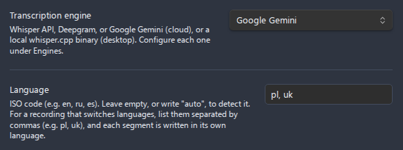
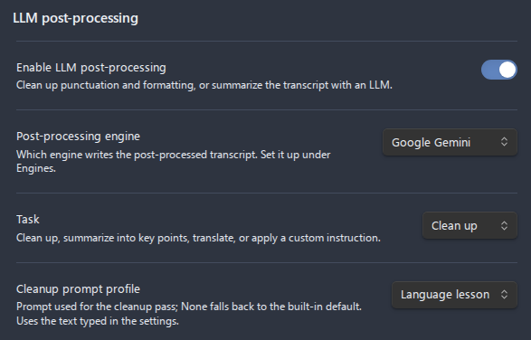

# Transcribe a language lesson

This guide turns a recorded lesson with a tutor into a transcript where every passage stays in the language it was spoken in and the student's own mistakes stay as they were made. It suits any lesson that moves between the language being learned and a language the student and the tutor share: a Polish lesson with a Ukrainian-speaking tutor, a Spanish lesson explained in English, a German one explained in Russian.

- [Goal](#goal)
- [Prerequisites](#prerequisites)
- [Step-by-step](#step-by-step)
    - [1. Choose Google Gemini](#1-choose-google-gemini)
    - [2. List the languages of the lesson](#2-list-the-languages-of-the-lesson)
    - [3. Turn on speaker labels](#3-turn-on-speaker-labels)
    - [4. Clean up with the Language lesson profile](#4-clean-up-with-the-language-lesson-profile)
    - [5. Record or transcribe the lesson](#5-record-or-transcribe-the-lesson)
- [What the transcript looks like](#what-the-transcript-looks-like)
- [Limits](#limits)

## Goal

A lesson recorded with one language set comes back in that language throughout: the passages in the other one are written in the first one's alphabet and lose their meaning. A Ukrainian explanation transcribed as Polish reads as `ale mój hramatek na początku bohater`, which is neither language. Listing both languages and cleaning the transcript with a profile written for lessons keeps each line in its own language and script, and keeps the errors that are the point of reviewing a lesson.

## Prerequisites

1. **A Google Gemini API key**, linked on the Google Gemini page under **Settings > Advanced Audio Recorder > Transcription > Engines**. See [Gemini API key](gemini-api-key.md).
2. **An engine for LLM post-processing**, such as Gemini itself, OpenAI or Anthropic. See [LLM post-processing](../llm-post-processing.md#enabling-it).

## Step-by-step

### 1. Choose Google Gemini

Open **Settings > Advanced Audio Recorder > Transcription** and set **Transcription engine** to **Google Gemini**. It is the one engine that can be told several languages at once: the others receive only the first code of a list, as the table in [Several languages in one recording](../transcription.md#several-languages-in-one-recording) shows.

### 2. List the languages of the lesson

Type every language the lesson holds into **Language**, as ISO codes separated by commas. For a Polish lesson with a Ukrainian-speaking tutor:

```text
pl, uk
```

Add a third code when the lesson regularly uses one, for example `pl, uk, be`. The note under the row confirms that each segment will be written in its own language.



### 3. Turn on speaker labels

Turn on **Speaker diarization**, so the tutor's lines and the student's lines are told apart. After the first transcription, give the two speakers their names with **Rename speakers**, as [Naming speakers](../transcription.md#naming-speakers) describes. A **Participant profile** holding the tutor's and your own name offers both names for every later lesson.

### 4. Clean up with the Language lesson profile

Under **LLM post-processing**, turn on **Enable LLM post-processing**, set **Task** to **Clean up**, and set **Cleanup prompt profile** to **Language lesson**. The plugin ships that profile beside **Default** and leaves it unused until you pick it, and an install that predates it receives it once on the first start after the update.



The profile tells the model to fix punctuation and clear recognition errors and nothing more: no translation, no respelling of one language in another's alphabet, and no correction of the student's grammar, word choice or word order. When the tutor corrects the student, both versions stay. Its full text is in [Default prompts](../llm-post-processing.md#default-prompts), and it can be edited like any other profile.

### 5. Record or transcribe the lesson

Record the lesson, or right-click an existing recording and choose **Transcribe audio**. The **Language** field of the Transcribe dialog holds the same list and can be changed for one run.

## What the transcript looks like

A lesson that opens in Ukrainian and goes on in Polish comes back with each line in its own language, including a question that switches language halfway:

```text
0:33 - Olga: Możemy od razu po polsku, czy chciałby pan na początku po-українськи щось мені повідомити?
0:39 - Anatol: Можемо і так, і так. Може, давайте одразу я розкажу, що я хочу.
14:27 - Olga: Jest? Dobrze. Andrzej to mój przyjaciel.
```

The JSON transcript file additionally records the language of every segment, as `"language": "uk"` or `"language": "pl"`.

## Limits

- **Only Google Gemini reads the list.** Whisper API, Deepgram and local whisper.cpp transcribe the whole lesson in the first language listed, and Mistral Voxtral detects one language for the whole recording.
- **A lesson longer than 15 minutes is sent in parts.** Each part is transcribed with the same languages, but speaker numbering can restart between parts, which renaming the speakers fixes.
- **A language you did not list is tagged with the closest listed one.** Its text is still written in its own script, so list every language the lesson regularly uses.
- **Cleanup cannot recover what recognition lost.** A passage the engine heard in the wrong language is garbled before the model sees it, and the cleanup leaves it as it is rather than guessing what was said.
